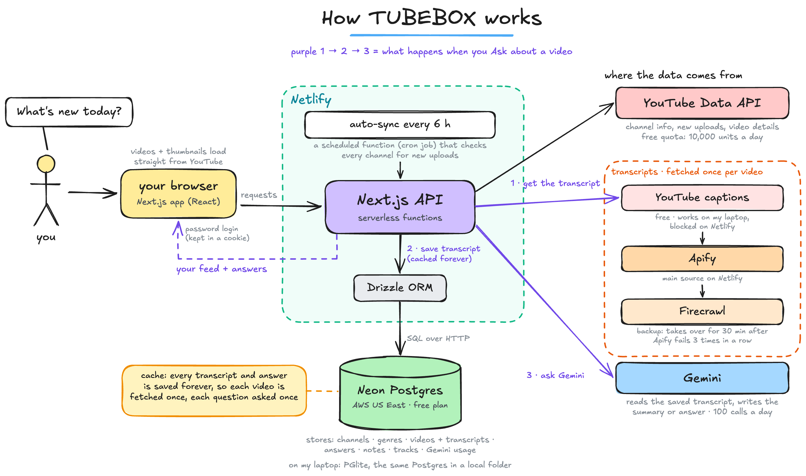

# 📺 TUBEBOX — your YouTube feed, no algorithm

A personal, distraction-free YouTube feed. You pick the channels; TUBEBOX
shows their uploads in chronological order — no recommendations, no rabbit
holes, no autoplay-into-oblivion. Plus AI comprehension tools that help you
decide *whether* to watch before you spend the time. Self-hosted, open
source, and runs entirely on free tiers.

> Deep dive: [docs/ARCHITECTURE.md](docs/ARCHITECTURE.md) — the full
> decision record, data model, quota math, and roadmap.

## Features

- **Your channels only** — add channels by URL, @handle, or plain name
  (with a "did you mean?" confirmation), organized into color-coded,
  user-defined genres
- **Backfill 1–5 years** — adding a channel pulls its history (1 year by
  default) from the official YouTube Data API — no scraping, no proxies.
  A scheduled function checks every channel for new uploads every 6 hours;
  the refresh button does it on demand
- **Inbox, newest first** — only unseen videos; tick ✓ Seen (with Undo) or
  save to Watch later. A video counts as watched once you've played half
  of it in the built-in player
- **Shorts, separated** — detected automatically, with their own tab and
  "Play unseen in a row"
- **Filters** — views, genres and channels (with counts) in a sidebar on
  wide screens, behind a Filters button on narrow ones; plus a length
  filter (under 10 min, 10–30 min, 30 min+)
- **Search everything (⌘K)** — fuzzy search across channels, video titles,
  saved answers and notes
- **💬 Ask** — ask anything about a video's content ("list all the
  interview questions asked"); answers are saved on the video for good.
  Your everyday questions, and one per genre, appear as one-click chips
- **✨ Summary** — 3–5 bullets + "worth watching if:", generated once and
  cached forever
- **📄 Transcript** — the full spoken text, searchable. It comes from
  YouTube's captions; on the hosted version (YouTube blocks cloud servers)
  through Apify, with Firecrawl as a backup. Running locally, Gemini can
  transcribe a video that has no captions — once, then cached
- **📓 Notebook** — every answer and note in one place: read them, ask
  follow-ups, copy as Markdown
- **🧭 Tracks** — learning paths: an ordered list of videos per topic, with
  progress and "Up next"
- **Channels page** — sortable table with each channel's last upload and a
  "quiet" status, bulk move / pause / delete, and your genres
- **Quota-aware AI** — a Gemini model fallback chain ranked by remaining
  daily budget, plus an app-wide daily cap, tracked in your own database
- **Password protected** — one env var, single user
- **Free everything** — Netlify + Neon Postgres + YouTube Data API +
  Gemini free tiers (and Apify's monthly free credit for hosted
  transcripts); well under every quota at personal scale

## Local development (zero setup)

```bash
git clone <this repo> && cd personal-feed-yt-insta
npm install
cp .env.example .env.local   # fill in YOUTUBE_API_KEY (see below)
npm run dev
```

That's it — with `DATABASE_URL` unset, an embedded Postgres (PGlite) is
created in `.data/` automatically. Open http://localhost:3000, click
**+ Add channel**, and add your first one.

### Getting the keys (all free)

| Key | Where | Notes |
| --- | --- | --- |
| `YOUTUBE_API_KEY` | [console.cloud.google.com](https://console.cloud.google.com) → new project → enable **YouTube Data API v3** → Credentials → Create API key | Required. Free 10,000 units/day (this app uses ~1%) |
| `GEMINI_API_KEY` | [aistudio.google.com](https://aistudio.google.com) → Get API key | Optional — enables summaries, ask, and AI transcripts |
| `DATABASE_URL` | [neon.tech](https://neon.tech) → new project → copy connection string | Only needed for deployment |
| `APIFY_TOKEN` | [console.apify.com](https://console.apify.com) → Settings → API & Integrations | Deployment only — fetches transcripts, since YouTube blocks cloud servers |
| `FIRECRAWL_API_KEY` | [firecrawl.dev](https://firecrawl.dev) → API keys | Optional, deployment only — backup when Apify fails 3 times in a row |

All configuration is environment variables — see
[.env.example](.env.example) for the complete annotated list (model chain,
backfill window, watch-length cap, etc.).

## Deploying to Netlify

1. Push this repo to GitHub and import it in
   [app.netlify.com](https://app.netlify.com). The Next.js runtime is
   detected automatically.
2. In **Project configuration → Environment variables**, add (ticking
   "Contains secret values" on each): `YOUTUBE_API_KEY`, `DATABASE_URL`
   (Neon), `APP_PASSWORD`, `CRON_SECRET` (any long random string),
   `GEMINI_API_KEY`, `APIFY_TOKEN`, and optionally `FIRECRAWL_API_KEY` and
   `GEMINI_MODEL` / `GEMINI_MODELS`.
3. Deploy. Tables create themselves on first use, and the scheduled
   function ([netlify/functions/feed-cron.mts](netlify/functions/feed-cron.mts))
   refreshes the feed every 6 hours.

## How it works

<picture>
  <source media="(prefers-color-scheme: dark)" srcset="docs/diagrams/tubebox-architecture-dark.png">
  
</picture>

<sub>Editable source: [docs/diagrams/tubebox-architecture.excalidraw](docs/diagrams/tubebox-architecture.excalidraw) (open it at excalidraw.com → Open).</sub>

- **No scraping for the feed.** Video data comes from the official YouTube
  Data API within its free quota. (Transcripts come from YouTube's
  captions; on the hosted version, where YouTube blocks cloud servers,
  they come through Apify, with Firecrawl as a backup.)
- **Old videos never disappear** — the database accumulates; YouTube is
  just the sync source.
- **Every AI result is computed once and cached** — summaries, answers,
  and transcripts live in your database.

## License

MIT — fork it, self-host it, make it yours.
