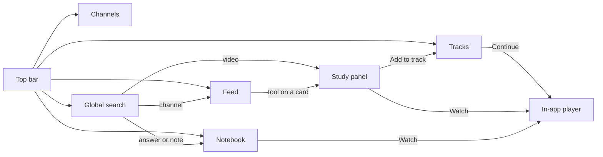
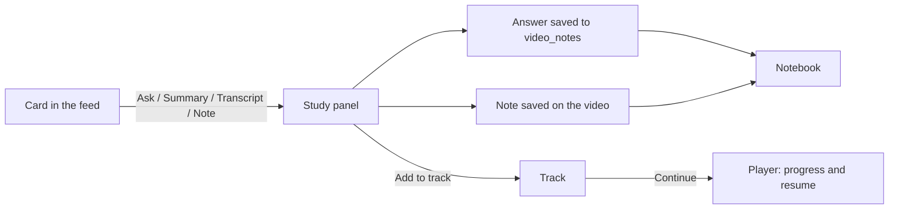
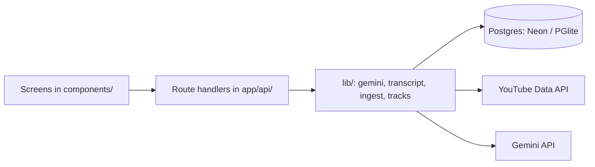

# TUBEBOX — UI/UX Redesign

> The working document for the redesign: what we're changing, why, how each
> change was built, and where we are. **New session? Start at "Resume here".**
> For how the system works underneath (data model, Gemini engine, ingestion),
> see [ARCHITECTURE.md](ARCHITECTURE.md) — this file doesn't repeat it.

Design source: Claude Design project "TubeBox Redesign" (rounds 2 and 3),
shared as https://claude.ai/artifact/MP44nprvvt3auamdQkwRYk

---

## ▶ Resume here

| | |
|---|---|
| **Status** | **All 8 phases built** (plus 4.1), uncommitted. Phase 8 awaiting the owner's review; 1–7 reviewed. The owner will test everything, then commit and push. ("Functionally brilliant; UI/UX a bit questionable": specifics to come for a polish pass.) |
| **Phases done** | 8 of 8 (plus 4.1) |
| **Next step** | The owner's full test, then commit and push (deploys to Netlify). Then a polish pass from the owner's UI/UX notes. Still ◐ and finished during polish: UI-03 layouts, UI-04 sentence case, REF-02 wording, REF-06 empty states on the remaining screens. |
| **Before deploying** | Phase 2 adds an `app_meta` table, Phase 3 an index on `video_notes(video_id)`, Phase 6 a `videos.last_played_at` column. Production creates all of them automatically on the next cold start; nothing to run by hand. |
| **Open questions** | The owner's specific UI/UX notes (to be sent) for a polish pass. |
| **Last updated** | 2026-10-17 |

*Update this block at the end of every session.*

---

## 1. Goals and retro rules

**Goals.** TUBEBOX works, but it grew feature by feature and the interface
shows it: seven buttons on every card, panels squeezed inside cards, an icon
legend for shorts, filters spread over five rows, the same heavy styling on
everything. The redesign makes it cleaner and easier to use while keeping its
personality — without losing a single feature.

**Retro rules — never broken:**
- Cream background, black outlines, hard offset shadows.
- The TV mascot is the logo.
- Bold display type for headings and labels.
- Colour is reserved for genres and the one primary action on a screen.
- Heavy treatment (thick shadow, filled yellow) only for primary or selected
  things; everything else stays light.

**Ground rules for the build:**
- Every existing feature keeps working throughout; we change the look and the
  layout, not the behaviour, unless an item says otherwise.
- One phase at a time; the owner checks each phase before the next.
- Free tier only. No new paid services.

---

## 2. Design system

The single source of truth for the look. Code follows these values.

### Colours

| Token | Value | Use |
|---|---|---|
| Background | `#fbf1dd` | Page |
| Ink | `#15130f` | Text, borders, shadows, filled/active controls |
| Primary | `#ffd02b` | The one primary action per screen, the selected sidebar row, count badges, the yellow inside icons |
| On primary | `#15130f` | Text on yellow |
| Surface | `#fffaf0` | Cards, panels, inputs |
| Panel | `#fff6de` | Top bar and feed sidebar: soft warm cream, a step warmer than the page |
| Tint 1 | `#fff3c4` / `#fff1bf` | Selected row, highlighted search match |
| Neutral 200 | `#f4e7ca` | Subtle fills, dividers |
| Neutral 300 | `#e6d5b2` | Quiet borders inside panels |
| Neutral 400 | `#cdbb96` | Disabled, placeholders |
| Muted text | `#8a7f70` / `#62594d` | Secondary text, metadata |
| Pink | `#ff9be3` | Small accents (badges, note marker) |
| Warning text | `#9a5800` | "No uploads 4 mo" and similar |

Genre colours stay **user-defined** (the genre colour picker built on
2026-10-15) — the redesign doesn't hard-code them. Text on a genre colour keeps
using `textColorFor()` so it's always readable.

### Type

| Role | Font | Notes |
|---|---|---|
| Body, buttons, inputs | Space Grotesk | Sentence case |
| Display: page titles, logo, section labels | Archivo Black | Caps allowed for short labels |
| Numbers: counts, durations, times, kbd | **Space Mono** *(new)* | So digits line up |

### Shape, borders, shadows

- **Corners: square** everywhere (no rounding).
- **Borders:** 2px ink on cards, panels, inputs and buttons; 1–2px neutral
  lines inside panels and tables.
- **Shadows (hard, no blur):** 3px on normal cards and buttons; 4–5px on the
  selected card and the primary button only.
- **Background:** cream with a faint dot grid (7% ink, the original strength;
  halving it in Phase 1 made the page feel washed out).

### Spacing

4px base scale: 4, 8, 12, 16, 24, 32.

### Icons — "sticker duotone"

Chosen 2026-10-16 over plain bold lines and 8-bit pixel icons (see UI-06).
- **One set, always drawn.** `components/ui/Icon.tsx`. Never a typed
  character (✕ ⟳ ▲▼ ✎) or an emoji (🎯 💬 📝) for a control.
- **Ink outline, 2.5px** on a 24px grid, shown at 16–17px.
- **Yellow fill only inside closed shapes** (bubble, page, star, pencil,
  copy, search lens, send). Open shapes (✕, arrows, lines, refresh) stay ink.
- **Switches don't get the fill** (the card's bookmark): a yellow bookmark
  would read as "saved". They show on/off by being filled in ink.
- **Active = filled black** (icon turns cream; the yellow stays).
- **Icon-only buttons always have an instant hover label**, placed so it's
  never cut off (below for buttons at the top of the page).

---

## 3. Decisions log

| Decision | Choice | Reason |
|---|---|---|
| Theme | Cream & yellow (original), refined | It's TUBEBOX's identity; "Paper & red" rejected |
| Logo | Keep the TV mascot | Ours is better than the design's placeholder |
| Logo hover | Speech bubble "your feed · no algorithm" | Keeps the tagline without the ticker |
| Ticker | **Dropped** | A constantly scrolling banner fights "stay focused" |
| Corners | Square | Matches the design; sharper retro-print look |
| Dot background | Keep, much fainter | Part of the identity, but quieter |
| Watch on YouTube | **Dropped** — in-app player only | YouTube's recommendations defeat the app's purpose, and leaving the app breaks honest-watched, resume and progress |
| Shorts card shape | Keep landscape | Real short thumbnails are landscape; portrait would crop text |
| Keyboard shortcuts | **Dropped**, except search: ⌘K, and ↑↓ / Enter / Tab / Esc inside the search panel | Not needed for navigation; search is where keys are expected |
| Merging similar question chips (Notebook) | **Dropped** | Every answer already shows under "Any" and in search |
| Track reordering | Keep ▲▼ buttons | Already built and reliable; drag-and-drop not needed |
| Ask suggestions | Genre suggestion + up to 3 everyday suggestions **you edit** | Config over code; empty list = today's behaviour |
| Notebook copy | "Copy as Markdown" per video + "Copy all" in a ⋯ menu | Both useful |
| Notebook reader scope | Filters choose videos; the reader always shows the whole video, matching answers marked | Answers vanishing while you read loses your place |
| Notebook address | `/notebook?v=<id>` for the open video | Reload keeps your place; Phase 8 search can link to it |
| Track "last watched" | New `videos.last_played_at`, stamped by progress saves only | A hand-ticked ✓ isn't watching; the stamp rides an update that already happens |
| Track label genre | The most common genre among its videos | Tracks have no genre of their own; nothing new to keep in step |
| Tracks order | Most recently watched first, then newest | The tracks you're on stay at the top |
| Video player | Restyled in Phase 6 (drawn ✕, channel and length, square frame) | Shared by every screen; it was the last old-style piece |
| Play unseen in a row | Marks a short seen only when it plays to the end; Next skips without marking | Skipping isn't watching (the honest-watched rule) |
| Shorts title | "Shorts", with the view in the line under it | Says where you are; the sidebar still marks the view |
| Space Mono for numbers | Yes | Digits line up neatly |
| Bulk re-sync (now Backfill) | One channel at a time; each in as many short requests as it needs (FEAT-10) | Netlify kills any request after 10 s |
| Top-bar search box | Appeared in Phase 8 with global search | A box that does nothing is worse than no box |
| Search results | Open the existing place (feed filtered, study panel, Notebook), no results page | Those screens already show each thing best |
| Search engine | ILIKE + trigram similarity, one parallel request; no full-text index | ~140 ms at personal scale; nothing new to maintain |
| "Synced X ago" source | New `app_meta` table, written by every sync | The newest video's time stays old when a sync finds nothing |
| Feed tab count | All unwatched, videos + shorts | The feed's own totals line shows the per-view numbers |
| Sidebar count rule | What clicking the row would show, keeping your other choices | One rule for views and genres, so numbers never contradict the grid |
| Sidebar channel counts | Unchanged: the channel's whole archive of this kind | Stable numbers that don't jump while browsing (an earlier deliberate choice) |
| Shorts card | Gets the new card in Phase 3, not Phase 7 | It's one component; a second, old-style card would mean keeping all the popup code alive |
| Study panel loading | A tab loads only when picked, once | Summary and transcript can cost a Gemini call; nothing is spent by just opening the panel |
| Everyday suggestions storage | `app_meta` row (`ask_suggestions`), edited on the Channels page | Three strings don't need a table; empty by default |
| Channels address | `/channels`; `/manage` forwards there | The nav says Channels; old bookmarks keep working |
| "Quiet" channel | Active, and no upload in 90+ days (or none stored) | Long enough to skip normal gaps; short enough to catch abandoned channels |
| Bulk changes | One request for move/pause/resume/delete; backfill one channel at a time | Netlify's 10 s limit only bites on re-sync, which calls YouTube |
| Delete confirm | An in-page sentence with the counts, not the browser's pop-up | It can say exactly what goes, including answers and notes |
| Title search | Stays in the feed's title row until Phase 8 | The top bar gets a search box only when global search works |
| Icon style | B, "sticker duotone": ink outline, yellow fill in closed shapes | Adds depth and the yellow; pixel icons (C) only stay crisp at fixed sizes |
| Yellow amount | Yellow for selection, counts, the main button and inside icons; bars on soft cream | Pale yellow bars read as "urine yellow" |

---

## 4. Feature status

What the design shows, compared with what TUBEBOX already has.

**Already built — only the look changes:** Inbox/Later/History/Everything ·
Videos/Shorts and length filters · "124 unseen · 38h 12m" totals · progress
bars and resume · Ask, Summary, Transcript, Note · Notebook and copy ·
Tracks with Continue, Up next and autoplay · genre colours and editing ·
channel search · formatted Gemini answers.

**Built, but needs a new layout:** top bar · feed sidebar · card · study panel ·
two-pane Notebook and Tracks · Channels table (replaces Manage).

**New features:** global search · sidebar counts · Seen + Undo · Play unseen in
a row · Ask from the Notebook · track "last watched" · channel last upload and
status · bulk channel actions · everyday Ask suggestions.

---

## 5. Change catalogue

Each change has an ID: **UX** (hard to use), **UI** (visual problems), **REF**
(refinements and polish), **FEAT** (new features).

### How items are written

An item starts as **planned** — *The problem* and *The change*. When it's
built, it gains *How it works*, *Key code*, *Alternatives considered*,
*Files* and *Verified*. Explanations are in plain English first; code is a
short excerpt of the key lines with comments, plus where to find the rest.

<details>
<summary>Example of a finished item (from an earlier change)</summary>

#### PERF-02 · Faster app start, without the two-at-once crash  — ✅ done · 2026-09-05

**The problem**
Every time Netlify starts a fresh copy of the app (a "cold start" — this
happens after a few idle minutes), the app first makes sure all its database
tables exist. It did this by sending about 15 separate instructions to the
database, one after another, waiting for each answer before sending the next.
The database is in the US and every trip there and back takes about a quarter
of a second, so the app spent roughly 3 seconds on this checklist before it
could show anything.

**The change**
The app now packs the whole checklist into one message and sends it once:
one trip instead of fifteen, so ~3 seconds became a fraction of a second.

That created a rarer problem. Netlify sometimes starts two fresh copies at
the same moment, and both ran the checklist at once. Because each checklist
now runs as one unbroken unit, both copies could end up holding something the
other needed and wait for each other forever — a "deadlock". The database
kills one of them and the page shows an error. This happened in production.

**How it works**
Think of a single-occupancy room with a "take a number" machine at the door.
Before a copy of the app touches any table, it takes the number for the room
"schema setup". The first copy goes in and runs its checklist. A second copy
arriving at the same moment waits at the door — *before* it has grabbed
anything, so it can't be holding something the first copy needs. When the
first copy finishes, the room frees up by itself, the second goes in, finds
every table already there, and finishes almost instantly.

Two details make this safe: every checklist step says "create this *if it
doesn't already exist*", so running it twice changes nothing; and the room
frees itself when the checklist ends, even if something fails midway.

**Key code** — `lib/db.ts` → `schemaSetupBlock()`
```ts
"DO $$ BEGIN",                              // start one combined message
`PERFORM pg_advisory_xact_lock(7201314);`,  // take the number for the room
`${DDL.join(";\n")};`,                      // the whole checklist
"END $$",                                   // finish — the room frees itself
```
`pg_advisory_xact_lock` is Postgres's built-in "take a number" lock. 7201314
is just the room's name; every copy of the app uses the same one.

**Alternatives considered**
- Back to 15 separate trips — fixes the crash, brings the slow start back.
- Catch the crash and retry — usually works, but hides the cause and adds a
  delay every time it happens.

**Files** — `lib/db.ts`

**Verified** — Netlify logs show one "cold init … 1 round trip" line per app
copy; the deadlock error hasn't appeared since.

</details>

---

### UX — things that were hard to use

#### UX-01 · Cards: two quick toggles and a tool strip — ✅ done · 2026-10-16
**The problem**
Every card carried seven full buttons (Mark seen, Later, Summary, Ask, Text,
Note, Track). On narrow shorts they needed an icon legend. Clicking one opened
a panel *inside* the card, so a chat box or a transcript got squeezed into a
few hundred pixels.

**The change**
Triage sits on the thumbnail: **✓ seen** top-left, **bookmark (later)**
top-right, filled when on. Below the title and channel, one tool strip:
**Ask** first with the number of saved answers, then icons for Summary,
Transcript, Note (a red dot when a note exists) and Add to track, each with an
instant hover label. The tool that's open is filled black and the card gets a
yellow shadow, so you can see which card the panel belongs to. No tool opens
anything inside the card any more; they all open the study panel (UX-02).
The emoji are replaced by simple line icons from the design.

**How it works**
The card stopped *doing* things and now only *reports* them. Before, each
card held its own summary, transcript and answers, plus the code to fetch
them. Now it holds nothing: clicking a tool tells the feed "open the panel on
this video, at this tab", and the panel does the work. A light switch
doesn't contain the lamp; it just tells the lamp what to do.

The answer count comes with the feed itself: each video in the page's
response now carries `answerCount`, counted in the same database query. A new
index on saved answers by video keeps that count instant.

The corner toggles sit *over* the thumbnail but aren't *inside* its play
button, because a button inside a button isn't allowed in HTML (the browser
would split them apart).

On narrow cards (shorts in six columns) the word "Ask" hides and only its
icon shows. That's decided by the card's own width, not the window's
(a *container query*), so the same card works in a wide grid, a narrow grid,
or beside the open panel.

**Key code** — `components/VideoCard.tsx`
```tsx
// The card only reports which tool was clicked; the panel does the work.
<StripButton active={activeTool === "ask"} onClick={() => onOpenTool(video, "ask")}>
  <Icon name="ask" />
  <span className="hidden @min-[12rem]:inline">Ask</span>  {/* hides on narrow cards */}
  {video.answerCount > 0 && <span>{video.answerCount}</span>}
</StripButton>
```
`lib/videoColumns.ts` adds `answerCount` to every video sent to the screen;
`components/ui/Icon.tsx` holds the line icons.

**Alternatives considered**
- *Keep the in-card popups and only restyle them*: the root problem is space;
  a 280px card can't hold a conversation.
- *A dropdown "Study ▾" menu on each card* (design round 1): one more click
  for the thing you do most (Ask).

**Files** — `components/VideoCard.tsx` (rewritten), `components/ui/Icon.tsx`
(new), `lib/videoColumns.ts`, `components/types.ts`, `lib/db.ts` (index)

**Verified** — cards show the corner toggles, the strip with hover labels, the
answer badge (1 on "Top 50 Kafka") and the note dot; the active tool fills
black and the card gets the yellow shadow.

#### UX-02 · Study panel on the right — ✅ done · 2026-10-16
**The problem**
AI features lived in tiny in-card popups; long answers and transcripts were
hard to read, and there was no single place to study a video.

**The change**
A panel on the right with the video's thumbnail, title, channel and length, a
yellow **▶ Watch** (or **Resume**) button for the in-app player, **Add to
track**, then four tabs: **Ask · Summary · Transcript · Note**.
- **Ask** is a conversation: your question on the right in black, Gemini's
  answer below with its age and a Copy link. Suggestions (FEAT-09) and the
  question box stay pinned at the bottom.
- **Summary** renders the saved summary with Copy.
- **Transcript** shows times in their own column, with a **Find** box that
  narrows the text to the passages mentioning a word and highlights it.
- **Note** is your note, with more room than before, saved automatically.

While the panel is open the grid narrows (four columns to three at 1440px)
instead of being covered. Esc closes it. On a phone the panel fills the
screen.

**How it works**
*One panel, many cards.* The feed remembers one thing: which video the panel
is showing, which tab, and whether the track chooser is open. Clicking a tool
on any card changes that; clicking the same tool again closes the panel.
Each time the video changes, the panel starts fresh (React's `key`, a name
tag: a new name means a new panel, not a reused one with old answers in it).

*Nothing costs anything by surprise.* A tab only loads when you pick it,
and only once. The summary, transcript and answers are all cached on the
server, so a second look is free. Opening the panel on Ask only reads saved
answers; Gemini is asked only when you send a question or press a
suggestion.

*Staying in agreement.* When the panel learns something new (a summary
arrives, an answer is added, the note changes) it tells the feed, which
updates the card: the answer badge goes up, the note dot appears. If the
video leaves the list (say you're on Later and it gets watched), the panel
keeps its own copy, so it doesn't vanish mid-read.

*Why the grid narrows instead of being covered.* The panel is a column
beside the grid, not a layer on top. The grid's column count follows the
width it actually has (a container query again), so it reflows from four
columns to three by itself.

**Key code** — `components/FeedClient.tsx`
```tsx
// The panel's whole state: which video, which tab, track chooser open?
const [study, setStudy] = useState<{ video: FeedVideo; tab: StudyTab; track: boolean } | null>(null);

// A new video means a new panel (fresh state), thanks to the key.
<StudyPanel key={studyVideo.id} video={studyVideo} tab={study.tab} … />
```
`components/StudyPanel.tsx` holds the tabs; `components/ui/SidePanel.tsx`
gained a pinned `footer` for the Ask box.

**Alternatives considered**
- *A pop-up window (modal) over the feed*: covers the grid, so you can't
  glance between videos while reading.
- *Expand the card in place*: the grid jumps around, and it's still narrow.
- *Load every tab as soon as the panel opens*: faster switching, but a
  summary or transcript can cost a Gemini call (or Apify on the live site)
  for something you may never read.

**Files** — `components/StudyPanel.tsx` (new), `components/FeedClient.tsx`,
`components/ui/SidePanel.tsx`, `components/NoteEditor.tsx` (larger style),
`components/CopyButton.tsx` (quiet style)

**Verified** — on "Top 50 Kafka Interview Questions" (1 saved answer, saved
summary): the conversation loaded, Summary rendered without calling Gemini,
Transcript loaded from the saved copy and "zookeeper" found 5 passages, Note
opened focused, Add to track listed tracks. The grid went from 4 to 3 columns;
Esc closed the panel.

#### UX-03 · One top bar — ✅ done · 2026-10-16
**The problem**
The header had four big buttons of equal weight (Refresh, Notebook, Tracks,
Add/Manage) plus a scrolling ticker, so navigation and actions competed. Each
of the other pages had its own header with a "← BACK TO FEED" button, which
meant every trip between Notebook and Tracks went through the feed.

**The change**
One strip across the top of every page, which stays in place while the page
scrolls: TV logo · **Feed · Notebook · Tracks · Channels** (with counts, the
current one filled black) · "Synced 4 min ago" with a small refresh icon ·
**+ Add channel** as the single yellow button. "Back to feed" buttons are
gone, since the bar goes anywhere from anywhere. The search box arrives with
global search in Phase 8; it isn't shown before it works.

**How it works**
The bar is one component, `TopBar`, that every page places at its top, so it
can't drift apart from page to page. It works out which tab to fill black
from the page's address (`/notebook` → Notebook). Channels points to the
existing Manage page until Phase 4 replaces it.

*"Synced 4 min ago."* TUBEBOX didn't record when it last checked YouTube. The
newest video's fetch time looks similar, but it's wrong: a sync that finds
nothing new leaves it unchanged, so the bar would say "3 days ago" right
after a sync. So the sync now writes its finish time into a new, tiny
**`app_meta`** table: a key/value notebook for app-wide facts (one row today:
`last_sync_at`). Both the refresh icon and Netlify's scheduled sync (every
6 hours) go through the same function, so either one updates it. The label re-reads the
clock every 30 seconds, so "just now" turns into "1 min ago" without asking
the server.

*Refresh.* The icon runs the same sync as the old REFRESH button and shows
the same result ("80 new videos — KodeKloud (17), …") in a yellow note under
the bar. Afterwards the bar recounts, and if the page has something to
reload (the feed does: new videos, channel counts), it's told to.

**Key code** — `components/TopBar.tsx`
```tsx
// Which tab is filled black: "/" must match exactly, the rest by prefix.
const isActive = (href: string) =>
  href === "/" ? pathname === "/" : pathname.startsWith(href);

// After a sync: recount the bar, and let the page reload its own data.
await Promise.all([loadNav(), onRefreshed?.()]);
```
`lib/ingest.ts` → `refreshAllChannels()` records the time at the end; the new
table is in `lib/schema.ts` (`appMeta`) and `lib/db.ts`.

**Alternatives considered**
- *Put the bar in the shared layout (`app/layout.tsx`)*: Next.js keeps a
  layout on screen across page changes, so the bar wouldn't reload its counts
  on every move. But the login page shares that layout and must not show the
  bar, and a layout can't hand the feed its "reload after sync" callback. The
  idiomatic fix is a *route group* (`app/(app)/layout.tsx` wrapping every
  page except login). That's worth doing later; it's a file move with no
  visible change.
- *Use the newest video's fetch time for "Synced"*: no new table, but it
  gives the wrong answer whenever a sync finds nothing (see above).
- *Show the search box now and wire it up in Phase 8*: rejected. A box that
  does nothing is worse than no box.

**Files** — `components/TopBar.tsx` (new), `lib/schema.ts`, `lib/db.ts`,
`lib/ingest.ts`; every page client (`FeedClient`, `NotebookClient`,
`TracksClient`, `ManageClient`, `StyleguideClient`) swaps its header for the
bar.

**Verified** — at 1440px the bar is 58px tall and stays put while scrolling,
and the current tab is filled black on Feed, Notebook, Tracks and Channels
(none on the style guide). It read "Not synced yet" on a fresh database;
after the refresh icon it read "Synced just now", the Feed count went from
1275 to 1355, and the note listed the 80 new videos. No console errors on any
page; production build passes.

#### UX-04 · Feed sidebar: views, genres and channels in one place — ✅ done · 2026-10-16
**The problem**
Filters were spread across the page: genre chips, a type row, a watched-state
row, search and length, and the channel rail — five places to look.

**The change**
A left sidebar with three sections, each row with a count:
- **Views**: Inbox, Later, History, Everything. Places, not filters.
- **Genres**: All genres plus each genre with its colour square.
- **Channels**: a filter box ("1 of 13 · Esc clears"), the first 8 channels
  with "Show all", picked channels kept at the top, and "Clear" when any are
  picked.

The sidebar has its own scroll, so a long channel list never pushes the feed
down. On narrow screens it hides behind a **Filters** button.

**How it works**
The sidebar is only a remote control. It shows the choices and reports
clicks; the feed keeps the choices and loads the videos, exactly as with the
old chips. The rules didn't change either: picking a genre clears the channel
choice (so the feed never silently empties), and channels are listed only
for the current genre.

**Key code** — `components/FeedSidebar.tsx`
```tsx
<SidebarItem label="Inbox" active={view === "unwatched"} count={facets.views.unwatched} onClick={() => onView("unwatched")} />
```
Built from the Phase 1 `SidebarSection` / `SidebarItem` pieces.

**Alternatives considered**
- *Keep chips across the top*: they wrap into several rows with 98 channels,
  and they scroll away with the feed.
- *Show all channels always*: a 98-row list buries Genres and Views under it.

**Files** — `components/FeedSidebar.tsx` (new), `components/FeedClient.tsx`

**Verified** — views, genres and channel picks filter the feed; "code dec"
narrows to Code Decode ("1 of 13"); Clear works; on a 375px screen the
sidebar opens from Filters.

#### UX-05 · Type and length as segmented controls — ✅ done · 2026-10-16
**The problem**
Videos/Shorts and the length chips sat in separate rows, away from what they
affect, and nothing said plainly what you were looking at.

**The change**
A title row: the view's name large ("Inbox"), and under it one line in Space
Mono saying what's on screen, e.g. "2 unseen from Code Decode matching "Top
50 Kafka" · 1h 32m · newest first". Beside it: the title search, **Videos |
Shorts**, and **Any length | < 10m | 10–30m | 30m +** (videos only).

**How it works**
The line under the title is put together from the same choices that load the
feed (view, genre or channels, search) plus the totals the server already
sends, so it can never disagree with the grid. The two controls are the
Phase 1 `SegmentedControl`. The title search stays here until global search
(Phase 8) gives the top bar a search box.

**Key code** — `components/FeedClient.tsx` → `subtitle()`
```ts
// "124 unseen in DSA · 38h 12m · newest first"
return `${count} ${noun}${scope}${matching} · ${formatTotalTime(seconds)} · ${order}`;
```

**Alternatives considered**
- *Keep chips for type and length*: chips read as "tags you can combine",
  but these are either/or choices; a segmented control shows exactly one is
  on.
- *Put type and length in the sidebar*: they change the shape of the grid,
  so they belong next to it, where you're looking.

**Files** — `components/FeedClient.tsx`

**Verified** — the line updates with view, genre, channel and search; Shorts
hides the length control.

#### UX-06 · Shorts use the same card grammar — ✅ done · card 2026-10-16 · title row 2026-10-17
**The problem**
Shorts got their own icon row and a legend explaining the icons, and the
Shorts tab looked like the videos page with a different switch flipped: no
sense of "this is the Shorts place", and no way to just watch them.

**The change**
- *The card (Phase 3, with UX-01):* shorts use the same card as videos:
  corner toggles, the tool strip ("Ask" shrinks to its icon on narrow cards),
  instant hover labels, so the legend row is gone. Cards stay landscape,
  because real short thumbnails are landscape.
- *The title row (Phase 7):* on Shorts the big title reads **Shorts**, with
  the same line under it ("921 unseen · 24h 25m · newest first"), the
  **Videos | Shorts** switch, and a yellow **▶ Play unseen in a row**
  (FEAT-04). The length switch stays hidden, since every short is under ~3
  minutes.

**How it works**
Shorts and videos are one page with one card component; the switch only
changes the "kind" the feed asks the server for. So the title row reads the
same switch: when it's Shorts, the title says so and the play button
appears. It only shows when there's something unseen to play. On History,
where everything is seen, it hides.

**Key code** — `components/FeedClient.tsx`
```tsx
<h1>{kind === "shorts" ? "Shorts" : VIEW_TITLES[view]}</h1>
{kind === "shorts" && videos.some((v) => !v.watched) && (
  <Button variant="primary" onClick={playUnseen}>▶ Play unseen in a row</Button>
)}
```

**Alternatives considered**
- *Portrait (9:16) cards for shorts*: decided against early (decisions log).
  Real short thumbnails are landscape, so portrait would crop them.
- *A separate /shorts page*: duplicates the sidebar, filters and counts for
  no gain; it's the same feed with a different kind.
- *Keep "Inbox" as the title on Shorts*: the design's "Shorts" says where
  you are; the view (Inbox, Later…) is still marked in the sidebar and in
  the line under the title ("unseen", "saved").

**Files** — `components/FeedClient.tsx`, `components/VideoCard.tsx` (Phase 3)

**Verified** — switching to Shorts showed the title "Shorts", "921 unseen ·
24h 25m · newest first" and the play button; six columns of the shared card.

#### UX-07 · Notebook as list and reader — ✅ done · 2026-10-17
**The problem**
The Notebook was one long scroll of blocks: a long answer pushed every other
video down the page, long answers had to be expanded one by one, and the
filters took three rows of chips.

**The change**
Two panes, like an email app:
- **List (left)**: the title, a search box, two dropdowns (**genre** with
  counts, **question**, i.e. questions you've asked at least twice), and an
  **All | Answers | My notes** switch, then every video with a small
  thumbnail, title, channel, answer count, "note" if it has one, and when
  it was last touched. The open video is marked in yellow. A ⋯ menu holds
  **Copy all N shown, as Markdown**.
- **Reader (right)**: the video's title, channel, length and age, **Copy as
  Markdown** and **Watch/Resume**, then every answer in the order you asked
  it, at a comfortable reading width, never cut short. Then the follow-up
  box (FEAT-05), then your note: shown with Edit, or a dashed "Add your own
  note" invitation.
- On a phone you get the list first; tapping a video opens the reader at its
  top, with "‹ All videos" to go back.

**How it works**
*Filters pick videos; the reader shows the whole video.* Search, question
and type decide which videos are listed. The reader always shows everything
for the chosen one, because when you're reading it's confusing for answers
to vanish. Answers that match the active question or search get a thick
yellow edge, so you can still see why the video is listed.

*Genre counts follow the other filters.* As in the feed sidebar, each
genre's number is what you'd get by picking it with everything else kept.

*The open video lives in the address* (`/notebook?v=1542`). Reloading keeps
your place, and global search (Phase 8) can link straight to an answer.
This uses `history.replaceState`, which changes the address without a page
load and without filling Back with every click.

*Still one request.* The page loads every answer and its videos once and
does all filtering in the browser, as before, so every click is instant.

**Key code** — `components/NotebookClient.tsx`
```ts
// Filters choose videos; the reader then shows the chosen one in full.
const visible = genreFilter === "all" ? beforeGenre : beforeGenre.filter(byGenre);
const selected = visible.find((e) => e.video.id === selectedId) ?? visible[0] ?? null;
```

**Alternatives considered**
- *Keep one scroll and collapse long answers* (the old page): still pushes
  everything around, and every long answer needs a click.
- *Show only the matching answers in the reader*: answers jumping in and
  out as you filter loses your place; marking them keeps the context.
- *Merge similar questions into one chip*: dropped earlier (decisions log).
  The question dropdown lists exact repeats, and search catches the rest.

**Files** — `components/NotebookClient.tsx` (rewritten)

**Verified** — 24 videos / 28 answers listed; choosing one updated the
address (`?v=1542`) and the reader; the question filter "List all the
questions asked in this video · 18" narrowed to 18 videos and marked the
matching answer; "My notes" (none yet) showed "No matches" instead of a
stale video; the note invitation opened the editor with the cursor in it;
the ⋯ menu offered "Copy all 24 shown"; on a phone the list → reader →
back flow worked with no sideways scroll; no console errors in a fresh tab.

#### UX-08 · Tracks as list and path — ✅ done · 2026-10-17
**The problem**
The list of tracks and a track's details took turns in one column: open a
track and the list disappeared behind "← ALL TRACKS". Progress was a plain
bar, "what's next" was a small UP NEXT tag inside the list, and every row
carried four buttons (▶ ▲ ▼ ✕) all the time.

**The change**
Two panes, like the Notebook:
- **Tracks (left)**: each with its genre colour, name, "3/12", a progress
  bar and "2h 10m left · last watched yesterday" (FEAT-06). The track you
  watched most recently is on top. **+ New track** opens a name box right
  there, and the new track opens straight away.
- **The chosen track (right)**: "TRACK · INTERVIEW" (the genre most of its
  videos are in), the name, "3 of 12 done · 2h 10m left", and drawn Rename
  and Delete buttons. Under it:
  - a **block bar**, one block per video: black = done, yellow = the next
    one, empty = still to do. Hover a block for its title. Very long tracks
    (over 60) get a plain bar, since blocks would be slivers.
  - an **Up next** card: thumbnail with how much is played, "UP NEXT · STEP
    4", title, channel, length, "resumes at 12:30", and **Continue** (or
    Resume). A finished track says so instead.
  - **the path**: every video in order with a numbered box (✓ when done,
    yellow for the next), title (click to play), channel, saved answers,
    length or "40%" if half-way, and ▲ ▼ ✕ that appear on hover (always
    shown on touch screens).
- **Delete** asks in-page: "Its 12 videos stay in your feed; only the track
  goes." **Rename** opens with the old name selected, so typing replaces it.
- The open track is in the address (`/tracks?t=34`); on a phone the list
  comes first, with "‹ All tracks" to go back.
- Autoplay is kept: when a video started here ends, the next one plays.

**How it works**
*The block bar is the track itself.* Each block is one video, coloured by
the same `watched` flag the rest of the app uses, so it can't disagree with
the list. "Next" is simply the first video in order that isn't watched; that
is also what Continue opens and what the yellow block and row mark.

*The genre label is worked out, not stored.* Tracks don't have a genre, but
their videos do. The server counts the genres of a track's videos and
picks the most common one.

*Order of the list.* Tracks sort by when you last watched any of their
videos (FEAT-06), then by when they were made. The tracks you're actually
working on stay at the top without you arranging anything.

**Key code** — `components/TracksClient.tsx` → `TrackPath`
```tsx
// One block per video: done, the next one, or still to do.
const nextIndex = videos.findIndex((v) => !v.watched);
{videos.map((v, i) => (
  <span className={v.watched ? "bg-ink" : i === nextIndex ? "bg-primary" : "bg-surface"} />
))}
```
`lib/tracks.ts` → `mostCommon()` picks the label's genre.

**Alternatives considered**
- *Drag-and-drop reordering*: decided earlier to keep ▲▼ (decisions log);
  they're now quieter, shown on hover.
- *Store a genre on each track*: one more thing to set and keep in step;
  the videos already say what the track is about.
- *Show only a window of steps around the next one* (the design's mock):
  hides where you are in a long track. The full list scrolls, and the next
  step is highlighted.

**Files** — `components/TracksClient.tsx` (rewritten), `lib/tracks.ts`
(`lastPlayedAt`, `genreId`, `mostCommon`)

**Verified** — on a temporary test track (deleted afterwards): New track
created and opened it (`?t=100`); three added videos showed three blocks;
▼ moved step 1 down, ✕ removed the last; Rename opened with the name
selected and saved; Delete showed the in-page confirm and removed it,
falling back to the "AI" track. On a phone, list → track → back worked with
no sideways scroll. No console errors in a fresh tab; build passes.

#### UX-09 · Channels page replaces Manage — ✅ done · 2026-10-17
**The problem**
Manage was a long list of large rows, each with a red Delete button; genre
editing was mixed in; it was hard to spot dead channels, and every change
was one channel at a time.

**The change**
A new page at **/channels** (the old /manage address forwards there):
- **Add bar** on top: URL, @handle or name · genre · **Backfill 1Y–5Y** ·
  yellow **Add**. Plain names still show "Found X. Is this the one?" first.
  The top bar's "+ Add channel" lands here with the cursor already in the box.
- **A dense table**: tick box · channel (photo, name, @handle) · genre (a
  chip you can change in one click) · videos (+ shorts) · last upload ·
  status · ⋯ menu. Click a row anywhere to tick it. Sort by name, videos or
  last upload. A find box and **All / Quiet / Paused** filters sit on top; the
  title line says how many are paused and links "1 quiet for 3+ months".
- **Bulk bar** (FEAT-08) replaces the toolbar once anything is ticked.
- **⋯ menu per row**: Backfill 1Y–5Y (was Re-sync; see FEAT-10), Pause/Resume, Delete…. Delete goes through the
  same confirm step as the bulk bar.
- **Genres panel** on the right: every genre with its channel count; click
  one to narrow the table, the pencil edits in place (name, colour,
  suggested question, delete with a confirm). **+ New** adds one.
- **Everyday Ask suggestions** (FEAT-09) moved here, under the genres.
- On a phone each row collapses to the name plus one summary line ("Tech ·
  76 videos · 16h ago · Active").

**How it works**
*Everything is on screen at once.* With ~100 channels, the page loads them
all in one request and does the finding, filtering and sorting in the
browser, so typing in the find box or clicking a genre is instant and costs
nothing. Paging would only add round trips.

*Changes are reports, not separate screens.* The row's genre chip, the ⋯
menu and the bulk bar all call the same few functions (move, pause, delete,
re-sync) with a list of channel ids, whether that list has one channel or
twenty. One code path, so a single-row change and a bulk change can't behave
differently.

*Delete is deliberate.* It's never one click: the black bar turns into a
sentence saying exactly what goes ("Delete 2 channels and their 115 videos?
Saved answers and notes on those videos go too."), with the button repeating
the count. That's the confirm the browser's own pop-up couldn't word as
clearly.

**Key code** — `components/ChannelsClient.tsx`
```ts
// Every change (one row or twenty) goes through the same call.
async function bulk(ids: number[], action: "move" | "pause" | "resume" | "delete", genreId?: number | null) {
  const res = await fetch("/api/channels/bulk", { method: "POST", body: JSON.stringify({ ids, action, genreId }) });
  …
}
```
`app/channels/page.tsx` is the route; `next.config.ts` forwards `/manage`;
`components/GenresPanel.tsx` is the right-hand panel.

**Alternatives considered**
- *Keep the Manage page and restyle it*: the problems were the shape (big
  rows, one-at-a-time actions, no "when did it last upload"), not the look.
- *Load the table a page at a time from the server*: right for thousands of
  rows; for ~100 it adds a wait to every click.
- *Keep `/manage` as the address*: the nav says "Channels", so the address
  should too; the forward keeps old bookmarks working.

**Files** — `components/ChannelsClient.tsx`, `components/GenresPanel.tsx`,
`app/channels/page.tsx` (all new); `next.config.ts` (forward);
`components/TopBar.tsx`, `FeedClient.tsx`, `StudyPanel.tsx`
(links), `AskSuggestionsEditor.tsx` (panel style),
`components/ui/Icon.tsx` (more, pause, trash, chevUp). Removed:
`components/ManageClient.tsx`, `app/manage/page.tsx`.

**Verified** — /manage forwards to /channels; ticking two rows showed the
bulk bar; Pause then Resume, and Move to Finance then back to each original
genre, all applied and were undone; the genre panel's counts followed
(Finance 0 → 2 → 0). Delete… showed the confirm sentence and Cancel backed
out. Interview in the panel narrowed to its 5 channels; Quiet showed the one
channel with no stored uploads; sorting by last upload put the newest first.
"+ Add channel" focused the box. No console errors; production build passes.

### UI — visual problems

#### UI-01 · Design tokens in one place — ✅ done · 2026-10-16
**The problem**
The app's colours lived in a handful of loosely named variables (`--paper`,
`--yellow`, `--accent`…) plus hard-coded values like `#fff` scattered through
components. Nothing tied them to the design, so the palette had drifted —
the yellow was `#ffc900` where the design uses `#ffd02b`, cards were pure
white instead of warm off-white — and every corner was rounded while the
design is square.

**The change**
Every design value now has one name and one definition: the colours, the
three shadow sizes, square corners and the number font. Changing a colour
anywhere in the app means changing one line.

**How it works**
Tailwind 4 has a special block in the stylesheet, `@theme`, for exactly this.
Anything declared there does two jobs at once: it becomes a normal CSS
variable, *and* Tailwind generates ready-made classes from it. Declaring
`--color-surface: #fffaf0` means components can simply write `bg-surface`,
`text-ink` or `border-ink`, and those always mean the design's values.

Corners use the same trick. Tailwind's `rounded-lg`, `rounded-xl` and friends
all read their size from theme variables, so setting those variables to `0`
squares every corner in the app — about 150 places — without touching a
single component. `rounded-full` is calculated differently and stays round,
which is what circular avatars need. (Today's pill-shaped chips also stay
round until their screens are redesigned in later phases.)

The old variable names didn't disappear: they became aliases that point at
the new tokens (`--yellow` now means `--color-primary`, and so on). Every
existing screen switched to the refined palette instantly, without being
edited, and new code uses the new names.

The dot grid on the background stays, at half its old strength.

**Key code** — `app/globals.css`
```css
@theme {
  --color-ink: #15130f;       /* becomes text-ink, border-ink, bg-ink */
  --color-primary: #ffd02b;   /* becomes bg-primary */
  --color-surface: #fffaf0;   /* becomes bg-surface */
  --shadow-hard: 3px 3px 0 var(--color-ink);   /* becomes shadow-hard */
  --radius-lg: 0;             /* rounded-lg is now square… */
  --font-mono: var(--font-space-mono), ui-monospace, monospace;
}
:root { --yellow: var(--color-primary); }      /* old name → new token */
```
The full list (13 colours, 3 shadows, corners, font) is at the top of the file.

**Alternatives considered**
- *Search-and-replace every colour and `rounded-*` class across components* —
  hundreds of edits for the same result, and nothing would stop values drifting
  again.
- *A separate Tailwind config file* — Tailwind 4 moved this job into the CSS
  `@theme` block; a config file would be the older, deprecated route.

**Files** — `app/globals.css`

**Verified** — in the running app: page background `rgb(251,241,221)`, primary
button `#ffd02b`, every element's corner radius `0px` (no rounded elements
left except intentional circles), cards on the off-white surface colour.

#### UI-02 · Visual hierarchy: heavy only where it matters — ✅ done · 2026-10-16
**The problem**
Every card had a 3px border and a 6px shadow, every input a 4px shadow, and
the hover state went up to 8px. With everything shouting, the yellow primary
button didn't stand out from a plain card.

**The change**
Outlines are 2px everywhere. Normal cards, chips and inputs cast a 3px
shadow; small inner panels 2px. Only the yellow primary button keeps a
heavier 4px shadow (5px on hover), and a hovered card lifts to 5px instead of
8px. Inputs now glow yellow when focused, instead of red.

**How it works**
The site's building blocks (`nb`, `nb-btn`, `nb-chip`, `nb-input` in the
stylesheet) are used by every screen, so changing their border and shadow
values re-weights the whole app in one go. They now take their shadows from
the three shared sizes defined in UI-01 rather than their own numbers, so the
hierarchy stays consistent as screens are rebuilt.

**Key code** — `app/globals.css`
```css
.nb     { border: 2px solid var(--color-ink); box-shadow: var(--shadow-hard); }
.nb-btn { border: 2px solid var(--color-ink); box-shadow: 4px 4px 0 var(--color-ink); }
.nb-btn:hover { box-shadow: var(--shadow-hard-lg); }   /* 5px — the heaviest */
```

**Alternatives considered**
- *Leave the old classes and only restyle as each screen is rebuilt* — the app
  would look inconsistent for weeks, half old and half new.

**Files** — `app/globals.css`

**Verified** — feed cards measure 2px border and 3px shadow; the primary
button 4px; Feed, Manage, Notebook and Tracks all load with no console errors.

#### UI-05 · Shared building blocks — ✅ done · 2026-10-16
**The problem**
Every screen built its own buttons, toggles and lists from scratch, so the
same idea looked slightly different on each page — and the redesign needs the
same pieces on every screen.

**The change**
Five reusable components in `components/ui/`, plus a style guide page that
shows them all. Later phases build screens from these instead of from
scratch.

| Component | What it's for |
|---|---|
| `Button` | Primary (yellow), secondary (outlined) and ghost buttons, two sizes. `buttonClass()` gives a link the same look. |
| `IconButton` | Square icon with an **instant** hover label, an "active" filled state, and an optional number badge or dot. |
| `SegmentedControl` | A row of exclusive choices in one frame (Videos \| Shorts, length). |
| `SidebarList` | `SidebarSection` + `SidebarItem` for the feed's left sidebar. |
| `SidePanel` | The right-hand panel: fixed header, actions and tabs; scrolling body. |

**How it works**
The icon button's hover label is the one already used on shorts, made
reusable. The browser's built-in `title` tooltip waits about a second before
appearing; ours is a small label inside the button that's hidden until the
mouse is over it, so it shows immediately. It also appears when the button is
reached with the keyboard, and the button carries an `aria-label`, so screen
readers announce it.

The segmented control and sidebar items are built for accessibility from the
start: the control is announced as a group of radio choices with the current
one checked, and the active sidebar item is marked as "current".

The **style guide** (`/styleguide`, behind the login like every page) shows
the colours, type and every component working, so the foundation can be
reviewed before any real screen uses it.

**Key code** — `components/ui/IconButton.tsx`
```tsx
<button aria-label={label} className="group relative …">
  {children}                                      {/* the icon */}
  <span className="… hidden group-hover:block group-focus-visible:block">
    {label}                                       {/* instant hover label */}
  </span>
</button>
```

**Alternatives considered**
- *A component library (shadcn/ui, Radix…)* — capable, but it brings its own
  look we'd have to fight to stay neobrutalist, plus dependencies for five
  small pieces.

**Files** — `components/ui/Button.tsx`, `IconButton.tsx`,
`SegmentedControl.tsx`, `SidebarList.tsx`, `SidePanel.tsx`;
`components/StyleguideClient.tsx`, `app/styleguide/page.tsx`

**Verified** — style guide checked in the running app: hover label appears
instantly, badge and dot render, active state fills black, segmented controls
and sidebar switch correctly, panel opens and closes.

#### UI-06 · Icons and warmth (Phase 3 review fixes) — ✅ done · 2026-10-16
**The problem**
The owner's review of Phase 3: the sync icon was a typed character (⟳) that
looked cheap, and its hover label was cut off at the top of the page; the app
had lost its yellow, retro feel; "Load more" had become a plain outlined
button; the tool icons looked "drawn with a light pen", with no depth; and
the text under "Inbox" was too faint.

**The change**
- **Icons:** one drawn set in the "sticker duotone" style: a heavier ink
  outline (2.5px, up from 2px) with a yellow fill inside closed shapes. The
  rules are in §2 *Icons*. The sync button uses the drawn refresh icon, its
  label opens below, and it spins while syncing.
- **Warmth, in measured doses:** the top bar and sidebar sit on a soft warm
  cream (`panel`); the selected sidebar row is solid yellow; counts are yellow
  badges again; the page's dot grid is back to its original strength.
- **Load more** is the yellow primary button again, with a down chevron.
- **Text:** the line under the title, card metadata and sidebar headings are
  darker and bolder.

**How it works**
Phase 1 had made each element quieter on its own (outlined buttons, grey
counts, fainter dots), and together that drained the yellow out. The fix puts
yellow back where the eye lands (selection, counts, the one main button,
inside icons) rather than everywhere, as the old design did.

*A first pass went too far:* pale yellow (`#fff3c4`) on the bars and a
warmer page read as "urine yellow" to the owner. So the bars got their own,
softer token, `panel` (`#fff6de`), and the page went back to `#fbf1dd`.

*How duotone is drawn:* each icon is two layers. The bottom layer repeats
the icon's closed outline, filled yellow and with no line; the top layer is
the normal ink outline. Drawing the fill first means the outline always sits
crisply on top.

**Key code** — `components/ui/Icon.tsx`
```tsx
// Yellow layer first (closed shapes only), then the ink outline on top.
{duotone && !filled && FILLS[name]?.map((d) => <path d={d} className="fill-primary" stroke="none" />)}
{PATHS[name].map((d) => <path d={d} />)}
```

**Alternatives considered**
- *A — bold line only* (what Phase 3 first shipped, thickened): clean, but the
  owner found it lacked depth and the retro feel.
- *C — 8-bit pixel icons*: the most retro, but pixel icons are only sharp at
  fixed sizes (12/24/36px) and clash with the smooth type. Proper pixel sets
  exist (e.g. Pixelarticons); the preview used hand-drawn samples.
- *An icon library (Phosphor duotone)*: popularised the two-layer look, but
  its second layer is a faint grey. Ours uses the brand yellow and needs no
  new dependency.

**Files** — `components/ui/Icon.tsx`, `components/ui/IconButton.tsx`
(`tipBelow`), `components/ui/SidebarList.tsx`, `components/ui/SidePanel.tsx`
(drawn ✕), `components/TopBar.tsx`, `components/VideoCard.tsx`,
`components/FeedClient.tsx`, `app/globals.css` (`panel`, dots)

**Verified** — the sync label "Check YouTube for new videos" shows in full
below the button; strip icons show the yellow fill (track and refresh stay
ink; the corner bookmark stays an outline until saved); Load more is yellow
with a chevron; production build passes.

**Done everywhere (Phase 6, 2026-10-17)** — the last typed icons went with
the Tracks rebuild, and the shared video player's "✕ CLOSE" became a drawn
✕ with an instant "Close (Esc)" label (its header now shows channel and
length, and "Resumed at 12:30 · Start over" is a normal button). No screen
uses a typed character or emoji as a control any more; the style guide
keeps the old emoji only as reference.

#### UI-03 · Consistent page layout — ◐ Feed done 2026-10-16 · other screens Phases 4–8
**The problem**
Feed, Manage, Notebook and Tracks each have a different header and layout.

**The change**
Every screen shares the top bar and the same page-title pattern (title, a
one-line summary in muted text, controls on the right).

#### UI-04 · Sentence case for controls — ◐ Feed done 2026-10-16 · other screens Phases 4–8
**The problem**
Almost every label is in capitals, which is slower to read.

**The change**
Buttons, tabs and messages in sentence case; capitals kept for the logo, page
titles and small section labels (e.g. "GENRES").

### REF — refinements

#### REF-01 · Logo with a hover tagline — ✅ done · 2026-10-16
**The problem**
The tagline "your feed · no algorithm" sat under a 72px logo on the feed only,
taking a whole header row for something you read once.

**The change**
The TV mascot (eyes still follow the cursor) and "TUBEBOX" form the logo at
the left of the bar. Hovering it, or reaching it with the keyboard, shows a
small speech bubble from the TV: "your feed · no algorithm". It just appears,
with no animation. Clicking the logo goes to the feed.

**How it works**
Same trick as the icon buttons' hover labels (UI-05): the bubble is always in
the page but hidden, and shown while the logo is hovered or focused. The
bubble's little pointer is a small square, rotated 45° and outlined on two
sides, so it reads as a triangle poking up toward the TV.

**Key code** — `components/TopBar.tsx`
```tsx
<Link href="/" className="group relative …">
  <Mascot size={40} /> TUBEBOX
  <span role="tooltip" className="… hidden group-hover:block group-focus-visible:block">
    <span className="… rotate-45 border-l-2 border-t-2" />  {/* the pointer */}
    your feed · no algorithm
  </span>
</Link>
```

**Alternatives considered**
- *Keep the tagline as visible text next to the logo*: it costs width in a
  bar that's already full, and you only need to read it once.

**Files** — `components/TopBar.tsx`

**Verified** — hovering the logo shows the bubble immediately (no
transition), placed under the TV; it hides when the mouse leaves.

#### REF-02 · Human wording — ◐ Feed done 2026-10-16 (TEXT → Transcript, "You're all caught up") · other screens Phases 4–8
Rename internal-sounding labels and rewrite messages as a person would say
them. Starting list:

| Today | New |
|---|---|
| INBOX / EVERYTHING / HISTORY | Inbox / Everything / History (sentence case, as places) |
| 📄 TEXT | Transcript |
| RE-SYNC | **Backfill 1Y–5Y** (FEAT-10): says what it does, and can reach further back |
| "…serverless functions time out before a watch finishes…" | "This video has no captions, so it can't be read here. Open it on your laptop once — after that it works everywhere." |
| NOTHING HERE YET (empty inbox) | "You're all caught up" |

#### REF-03 · Space Mono for numbers — ✅ done (font installed) · 2026-10-16
**The problem**
Counts, durations and times were set in the same proportional font as the
text, where a "1" is narrower than an "8". Columns of numbers (counts in a
list, durations on cards) wobbled instead of lining up.

**The change**
Space Mono is loaded alongside the two existing fonts. Writing `font-mono` on
any element now uses it — counts, durations, timestamps and "Synced 4 min ago"
switch to it as their screens are rebuilt.

**How it works**
Next.js downloads the font at build time and serves it from TUBEBOX itself
(`next/font`), so there's no request to Google when a page loads — the same
way Space Grotesk and Archivo Black are already loaded. Every Space Mono
character is the same width, which is why columns of numbers line up.

**Key code** — `app/layout.tsx`
```ts
const mono = Space_Mono({ variable: "--font-space-mono", weight: ["400", "700"] });
```
`globals.css` maps Tailwind's `font-mono` to `--font-space-mono` (see UI-01).

**Alternatives considered**
- *Tabular figures in the existing font* (`font-variant-numeric:
  tabular-nums`): lines digits up without a new font, but Space Grotesk's
  support is partial and it loses the typewriter feel that suits the retro
  look.
- *The system's monospace font*: free, but looks different on Mac and
  Windows.

**Files** — `app/layout.tsx`, `app/globals.css`

**Verified** — the style guide's number line renders in "Space Mono".

#### REF-04 · Loading placeholders — ✅ done · 2026-10-16
**The problem**
"LOADING…" in the middle of the page, and the old grid staying put until the
new one arrived, so clicks felt ignored on a slow connection.

**The change**
While a new set of videos loads, the grid shows grey placeholder cards of the
same shape (8 for videos, 12 for shorts); "Load 24 more" adds 4 at the end.

**How it works**
Loading now knows *what* is loading: "first" replaces the grid with
placeholders, "more" appends them. Each request also takes a ticket number,
and only the newest ticket may update the screen. Without that, clicking
Inbox then quickly History could show Inbox's results last if they happened
to arrive later.

**Key code** — `components/FeedClient.tsx` → `loadPage()`
```ts
const id = ++requestId.current;         // take a ticket
// … await the response …
if (id !== requestId.current) return;  // a newer request owns the screen
```

**Alternatives considered**
- *A spinner*: says "wait" but not what's coming; the page still jumps when
  the cards arrive.
- *Keep the old grid until the new one loads*: no jump, but on a slow
  connection the click looks ignored, and you can end up acting on the
  wrong videos.
- *Cancel the old request* (`AbortController`) instead of ignoring its
  answer: also works; the ticket is simpler and leaves nothing to clean up.

**Files** — `components/FeedClient.tsx` (`SkeletonCard`)

**Verified** — placeholders appear on view/genre changes and before more
loads; quick clicks end on the last choice.

#### REF-05 · Remove the ticker — ✅ done · 2026-10-16
**The problem**
A banner scrolling "NO ALGORITHM · STAY FOCUSED…" forever sat above the feed.
Something moving at the edge of your eye is a distraction, the opposite of
what it said.

**The change**
Removed, along with its styles and animation. The logo's speech bubble
(REF-01) keeps the personality.

**How it works**
Nothing replaces it: the phrase list, the banner and its CSS (the `marquee`
animation, `.ticker-track`, `.nb-ticker`) are deleted, not hidden.

**Key code** — nothing added; this is what was removed from `app/globals.css`:
```css
@keyframes marquee { from { transform: translateX(0) } to { transform: translateX(-50%) } }
.ticker-track { animation: marquee 30s linear infinite; }
```

**Alternatives considered**
- *Keep it but stop the scrolling*: a static strip of slogans is just
  clutter between the bar and the feed.
- *Hide it with CSS*: dead code that someone later wonders about; deleting
  is cleaner, and git keeps the history.

**Files** — `components/FeedClient.tsx`, `app/globals.css`

**Verified** — no ticker element on the feed; no remaining references to
`ticker` or `marquee` in the code.

#### REF-06 · Empty states that say what to do next — ◐ feed done 2026-10-16 · other screens Phases 4–8
Each empty screen names the place and offers the next step. The feed's, most
specific reason first: no channels yet ("+ Add channel"), search with no
matches ("Clear search"), nothing at that length ("Any length"), Later empty
("Use the bookmark on any card"), Inbox empty ("You're all caught up" → "See
everything"), History empty. In `FeedClient.renderEmptyState()`.

### FEAT — new features

#### FEAT-01 · Global search — ✅ done · 2026-10-17
**The problem**
Each page could only search itself: the feed searched titles in the view
you were on, the Notebook searched answers, the Channels page searched
names. To find "that Kafka answer" or "the channel with 'decode' in it" you
had to know which page to go to first.

**The change**
A **search box in the top bar** on every page ("Search everything", with a
⌘K hint). Typing shows a panel of results in three groups, **Channels ·
Videos · Answers & notes**, with scope tabs and counts ("All 25 · Channels
0 · Videos 17 · Answers & notes 8"):
- **Channels**: photo, name, @handle, video count.
- **Videos**: thumbnail, title, channel, age and length; "Seen" on ones
  you've watched, so search doubles as "where was that video".
- **Answers & notes**: GEMINI or NOTE tag, **the line that matched** (not
  just the video title), and the question and video it belongs to.
- Matching words are highlighted. Starting with **`@`** searches channels
  only.
- **Where results go:** a channel opens the feed showing just that channel
  (all of it, on Everything); a video opens the feed with its **study
  panel** open; an answer or note opens it in the **Notebook**; "Show
  'kafka' in the feed →" opens the feed with that search filled in.
- **Keys:** ⌘K / Ctrl+K jumps to the box from anywhere; ↑↓ move, Enter
  opens, Tab changes scope, Esc closes. Clicking the dimmed page closes it.
- On a phone the box gets its own row in the top bar, and results open just
  under it.

**How it works**
*One request, three questions.* The server runs the channel, video and
answer/note searches at the same moment and sends one answer with the top
results of each and their totals (about 140 ms locally). Videos use the
same matching the feed's search box uses: the words appear in the title,
*or* the title is close (typo-tolerant, Postgres's trigram similarity), so
"kubernets" still finds Kubernetes. Titles that really contain the words
come first, then the newest. Answers and notes are matched by containment,
and the server cuts out the text around the first match so you see *why*
it matched.

*Search is a door, not a page.* Results don't get their own screen; each
one opens the place that already shows that thing best. To do that the
feed now accepts three address hints: `/?channel=5`, `/?video=42`,
`/?q=kafka`. It applies them, then tidies the address back to `/`, so a
reload doesn't re-apply an old search over what you've done since. The
Notebook's `?v=` address (Phase 5) was built for exactly this. Opening a
video needs its details even if it isn't loaded in the feed, so there's a
small new "one video" read (`GET /api/videos/:id`).

*Typing doesn't flood the server.* It waits for a 200 ms pause, and only
the newest answer is shown, the same "ticket" trick as the feed (REF-04).
A `%` or `_` you type is searched literally, not treated as a wildcard.

**Key code** — `lib/search.ts` and `components/FeedClient.tsx`
```ts
// lib/search.ts: all groups in one round trip.
const [channelRows, videoRows, [videoCount], answerRows, [answerCount], noteRows, [noteCount]] =
  await Promise.all([channelQuery, videoQuery, videoTotal, answerQuery, answerTotal, noteQuery, noteTotal]);

// FeedClient: a search link lands here, is applied, and the address is tidied.
if (channel) { setChannelIds([channel]); setView("all"); }
router.replace("/", { scroll: false });
```

**Alternatives considered**
- *A search results page*: one more screen to design and keep in step; the
  feed, the study panel and the Notebook already display each kind of
  result well.
- *A full-text search index* (Postgres `tsvector`, or an external service):
  better ranking at large scale, but a new column, index and sync to
  maintain. At personal scale ILIKE plus trigram answers in ~140 ms.
- *Search everything in the browser*: would mean downloading every answer
  and title up front.
- *A number on "See all"*: removed after testing. Search counts videos and
  shorts together, but the feed shows one kind at a time, so "See all 17"
  landed on 9.

**Files** — `lib/search.ts`, `app/api/search/route.ts`,
`components/GlobalSearch.tsx` (all new); `components/TopBar.tsx` (the box),
`components/FeedClient.tsx` (address hints), `app/api/videos/[id]/route.ts`
(`GET` one video)

**Verified** — "kafka": 17 videos, 8 answers with the matching lines, 12
highlights, first row active; ↓, Tab (scope → Videos) and Enter opened the
second video in its study panel, address back to `/`. From the Notebook,
"@code" listed 5 channels only, and Enter opened the feed on "23 videos from
Code Decode". An answer opened `/notebook?v=1522`; "Show 'kafka' in the
feed" filled the feed's search. "50%" searched literally; "kubernets" found
Kubernetes. On a phone the panel opens under the box (190 → 196 px), no
sideways scroll. No console errors in a fresh tab; build passes.

#### FEAT-02 · Sidebar and nav counts — ✅ done · nav 2026-10-16 · sidebar 2026-10-16
**The problem**
You couldn't tell how much was waiting anywhere without opening it.

**The change**
Counts next to the nav tabs (Phase 2): **Feed** = everything unwatched (videos
and shorts), **Notebook** = saved answers plus personal notes, **Tracks** =
number of tracks. Channels has none.

Counts in the feed sidebar (Phase 3): every view and every genre. The rule
for all of them: **the number is what you'd see if you clicked that row,
keeping your other choices.** On Shorts with "kafka" typed, Inbox shows the
unseen kafka shorts, and each genre shows its share of that. Channel counts
are the one exception: they stay each channel's whole archive of the current
kind, as before, so they don't jump around while you browse.

**How it works**
*Getting the nav numbers.* One endpoint, `/api/nav`, returns all three counts
plus the last sync time. Its four small database questions are sent at the
same moment rather than one after another, so on Neon (where each question
is a ~250ms round trip) the bar costs one wait, not four.

*Getting the sidebar numbers.* They arrive with the first page of the feed,
in the same request, so they cost no extra round trip. The server builds the
feed's filter as separate pieces (type, view, genre, channels, search,
length). For the view counts it leaves out only the *view* piece and counts
all four views in one pass, using Postgres's `FILTER`: one trip through the
table with four tally marks, not four trips. For the genre counts it leaves
out *genre and channel* and groups by genre. "Load more" skips all of this.

*Keeping them fresh.* When you mark a video watched, save a note, get an Ask
answer or create a track, the number in the bar should change. The card that
did it doesn't know the bar exists, and shouldn't. Instead it rings a bell:
it fires a browser event called `tubebox:nav-changed`. The bar listens for
that bell and recounts. Like a doorbell, the person ringing doesn't need to
know who's home. The bar waits a moment before recounting, so ticking off five
videos in a row costs one recount, not five. The sidebar is adjusted on the
spot instead (Inbox −1, History +1, that genre −1), since the feed already
knows exactly what changed.

**Key code** — `app/api/videos/route.ts` and `lib/nav-events.ts`
```ts
// All four view counts in one pass: the filter minus its "view" piece.
db.select({
  unwatched: sql`count(*) FILTER (WHERE watched = false)`,
  watched:   sql`count(*) FILTER (WHERE watched = true)`,
  later:     sql`count(*) FILTER (WHERE later_at IS NOT NULL)`,
  all:       sql`count(*)`,
}).where(and(...kindC, ...genreC, ...channelC, ...searchC, ...lengthC));

// lib/nav-events.ts: any component can say "counts may have changed".
export function notifyNavChanged() {
  window.dispatchEvent(new Event("tubebox:nav-changed"));
}
```
The bell is rung from: `FeedClient` (watched toggle, auto-watched at 50%,
bulk add), `StudyPanel` (answer saved), `NoteEditor` (note saved),
`TrackMenu` and `TracksClient` (track changes, end of a viewing session),
`ManageClient` (channel added or removed).

**Alternatives considered**
- *Pass a "recount" function down from the page to every card*: works, but it
  threads through several layers of components that don't otherwise care.
- *A shared state library or React context*: more machinery than a few
  numbers need.
- *Recount on a timer*: the numbers would lag, and the database would be
  queried every few seconds for nothing.
- *Sidebar counts from a separate endpoint*: one more round trip on every
  filter click, for numbers that only matter alongside the page.

**Files** — `lib/nav.ts`, `app/api/nav/route.ts`, `lib/nav-events.ts`
(Phase 2); `app/api/videos/route.ts` (`facets`), `components/FeedSidebar.tsx`,
`components/FeedClient.tsx` (`bumpFacets`) (Phase 3)

**Verified** — nav: Feed 1275 → 1355 after a sync, Notebook 28, Tracks 1.
Sidebar: marking a video seen moved Feed 1355 → 1354, Inbox 2 → 1, History
0 → 1 and the genre total 8 → 7 at once; Undo put every number back.

#### FEAT-03 · Seen with Undo — ✅ done · 2026-10-16
**The problem**
A misclick on "seen" could send a video somewhere you'd have to go and find.

**The change**
Ticking ✓ dims the card in place and shows **Seen · ↶ Undo** on the
thumbnail. Undo (or ticking ✓ again) brings it straight back. The card leaves
Inbox the next time the feed loads. On History, where everything is seen,
cards aren't dimmed.

**How it works**
Ticking saves straight away, as before. The card simply isn't removed from
the screen; it changes how it looks. Undo is the same toggle in reverse, so
there's no "pending" state to lose if you navigate away.

**Key code** — `components/VideoCard.tsx`
```tsx
const dimmed = video.watched && dimSeen;   // dimSeen is false on History
{dimmed && <div>Seen <button onClick={() => onToggleWatched(video)}>Undo</button></div>}
```

**Alternatives considered**
- *Wait a few seconds before saving, with a countdown*: if the tab closes in
  that window the tick is lost, and the counts would be briefly wrong.

**Files** — `components/VideoCard.tsx`, `components/FeedClient.tsx`

**Verified** — tick then Undo on "Most Asked Kafka Scenario…": dimmed with
Seen · Undo, then restored, and the database matched each step.

#### FEAT-04 · Play unseen in a row — ✅ done · 2026-10-17
**The problem**
Watching shorts meant open one, close, open the next, close: dozens of
clicks for something meant to be quick.

**The change**
**▶ Play unseen in a row** on Shorts plays the unseen shorts on screen one
after another, newest first, in the portrait player. The player shows
**"SHORT 2 OF 921 UNSEEN"** and a **Next ›** button.
- A short that **plays to the end** is marked seen, and the next one starts.
- **Next** skips without marking it seen, since skipping isn't watching. If
  YouTube's player can't load and the simple fallback player is used
  (which can't report "ended"), Next is how you move on.
- When the loaded shorts run out, the next page is fetched and the line
  carries on; at the very end you get "That's every unseen short here."
- Closing the player stops the run.

**How it works**
*A line of shorts, and a finger on the current one.* Pressing the button
takes the unseen shorts already on screen as a list, and the player shows
the one at the current position. When the player reports "ended" (the same
signal track autoplay uses), that short gets the normal ✓ (so counts,
Seen · Undo and the top bar all update as if you'd ticked it), and the
finger moves one along. Next moves it along without the ✓.

*Running past the loaded page.* The feed shows 24 shorts at a time. When the
finger reaches the end and the server said there's more, the page loader
fetches the next 24 (the same "Load more" the button at the bottom uses),
which now also *hands back* what it loaded, so the line can grow with the
unseen ones. The "of 921" comes from the sidebar's Inbox count for shorts
with your current filters, so it matches what you see.

*A fresh player per short.* Each short gets its own player (React's `key`),
so its resume point and timers start clean rather than carrying over from
the previous one.

**Key code** — `components/FeedClient.tsx`
```ts
async function queueEnded() {          // a short played to the end
  if (current && !current.watched) await toggleWatched(current);   // the normal ✓
  await advanceQueue();                // next one; loads another page if needed
}
```
`components/PlayerModal.tsx` takes an optional `queue` (label + onNext) for
the header.

**Alternatives considered**
- *Mark each short seen when it starts*: a short you skip after two seconds
  would vanish from the inbox. The honest rule is to count it when it's
  watched.
- *Fetch every unseen short up front*: up to hundreds of rows before the
  first one plays. Growing the line a page at a time starts instantly.
- *Use YouTube's own playlist player*: it brings YouTube's suggestions and
  autoplay rules back in, exactly what TUBEBOX avoids, and loses honest
  progress tracking.

**Files** — `components/FeedClient.tsx` (`playUnseen`, `advanceQueue`,
`queueEnded`; `loadPage` returns what it loaded), `components/PlayerModal.tsx`
(`queue` prop)

**Verified** — Play unseen opened "SHORT 1 OF 921 UNSEEN" ("COMPLETE AWS
Roadmap…"); Next moved to "SHORT 2 OF 921 UNSEEN" with the next short;
closing stopped the run; neither short was marked seen. *Not run live:* a
short playing to its end. It would mark a real short seen. That path is the
normal ✓ plus the same "next" step that Next uses, and the "ended" signal is
the one track autoplay already relies on.

#### FEAT-05 · Ask from the Notebook — ✅ done · 2026-10-17
**The problem**
Reviewing an answer in the Notebook and wanting to ask one more thing meant
going back to the feed, finding the video, and opening its panel.

**The change**
Under the answers in the reader: **"Ask a follow-up about this video"**. The
new answer appears in place, at the end, and the list's counts and the top
bar's Notebook count update.

**How it works**
It's the same Ask as in the feed's study panel: the same endpoint, the same
saved answers, the same cost. A question you've asked before comes back as
the saved answer without calling Gemini, and isn't listed twice. While it
works, a dashed card shows your question with "Thinking…".

**Key code** — `components/NotebookClient.tsx` → `Reader.ask()`
```ts
const res = await fetch(`/api/videos/${video.id}/ask`, { method: "POST", body: JSON.stringify({ prompt }) });
onAnswer(data.note);   // replaces a same-id answer, so a repeat isn't shown twice
notifyNavChanged();    // the top bar's Notebook count
```

**Alternatives considered**
- *Open the feed's study panel from the Notebook*: one shared panel, but the
  reader already shows the answers at full width; a second panel on top
  would duplicate them in a narrower column.
- *Suggestion buttons here too* (genre + everyday, as in the panel): left out
  to keep the reader calm. You come here to review, and a typed follow-up is
  the usual move. Easy to add if wanted.

**Files** — `components/NotebookClient.tsx`

**Verified** — re-asking "List all the questions asked in this video" on a
video that already had it returned the saved answer (`cached: true`, no
Gemini call); the answer count stayed 1 and the box cleared.

#### FEAT-06 · Track "last watched" — ✅ done · 2026-10-17
**The problem**
A track showed how much was left, but not when you last worked on it, so a
track you'd drifted away from looked the same as one you used yesterday.

**The change**
Each track in the list says **"last watched today / yesterday / 3d ago"**,
and the list is ordered by it, most recent first.

**How it works**
TUBEBOX knew *whether* a video was watched, never *when*. So videos get one
new column, **`last_played_at`**. While a video plays, the player already
saves progress every 15 seconds; that same save now also stamps the time.
No extra request, just one more field in an update that was happening
anyway. A track's "last watched" is the latest stamp among its videos.

Only real playing counts. Ticking ✓ by hand doesn't set it, because that
isn't watching. Videos played before this change have no stamp, so a track
shows "last watched" only from its first play after deploying.

**Key code** — `app/api/videos/[id]/route.ts`
```ts
// A progress save means it's being played right now — the tracks page's
// "last watched". Same UPDATE, so it costs nothing extra.
updates.lastPlayedAt = new Date();
```
`lib/schema.ts` adds the column and `lib/db.ts` creates it (`ALTER TABLE
videos ADD COLUMN IF NOT EXISTS last_played_at`), automatically on the next
start, like every earlier column.

**Alternatives considered**
- *Use `personal_note_at` or answer times as "activity"*: those are about
  studying, not watching, and are missing for tracks you only watch.
- *A watch-history table (one row per sitting)*: would allow "watched 3
  times this week", but nothing needs that yet. One column answers the
  question.
- *Count a hand-ticked ✓ as "watched now"*: the tick is often used to clear
  things you'll never watch, which would make the label lie.

**Files** — `lib/schema.ts`, `lib/db.ts`, `app/api/videos/[id]/route.ts`,
`lib/tracks.ts`, `components/TracksClient.tsx`

**Verified** — a progress save that marked no chunks played (so no watched
time was added) stamped the video; its test track then read "last watched
today" and moved to the top of the list; the "AI" track, never played since,
shows only "54m left".

#### FEAT-07 · Channel last upload and status — ✅ done · 2026-10-17
**The problem**
Nothing showed when a channel last posted, so channels that had gone quiet
sat in the list unnoticed.

**The change**
A **Last upload** column ("16h ago", "2mo ago") and a **Status**: *Active*,
*Paused*, or, in warning colour, *No uploads 4 mo* when a channel hasn't
posted for over 3 months (*No uploads stored* if none were ever fetched).
The **Quiet** filter and the "N quiet for 3+ months" link show just those.

**How it works**
No new storage. The server already has every video with its publish date,
so when it lists channels it asks the database, in one grouped pass over the
videos, for each channel's newest date along with its video and shorts
counts. Before, it asked only for the counts, so the extra date is free.
"Quiet" is decided in the browser: active and newest upload over 90 days
ago. A paused channel shows as Paused instead, since it isn't being checked
anyway.

**Key code** — `app/api/channels/route.ts`
```ts
// One grouped pass: counts of each kind plus the newest upload, per channel.
db.select({
  channelId: videos.channelId,
  videoCount: sql`count(*) FILTER (WHERE is_short = false)`,
  shortCount: sql`count(*) FILTER (WHERE is_short = true)`,
  lastUploadAt: max(videos.publishedAt),
}).from(videos).groupBy(videos.channelId);
```

**Alternatives considered**
- *Ask YouTube for each channel's latest upload*: exact even beyond the
  backfill window, but 100 extra API calls per page view.
- *Store a `last_upload_at` column, updated on every sync*: one more thing to
  keep in step; the grouped query is already fast at this size.

**Files** — `app/api/channels/route.ts`, `components/ChannelsClient.tsx`
(`statusOf`, `isQuiet`)

**Verified** — the column reads as expected (e.g. KodeKloud "7h ago",
Selenium Express "2mo ago"); sudoCODE, with nothing stored, shows "No uploads
stored" and is the one channel under Quiet; sorting by last upload puts the
newest first.

#### FEAT-08 · Bulk channel actions — ✅ done · 2026-10-17
**The problem**
Re-organising channels meant changing them one by one: a genre dropdown here,
a pause button there, a confirm pop-up for each delete.

**The change**
Tick channels (or the header box for everything shown) and a black bar
replaces the toolbar: **N selected · Move to genre… · Backfill… (Re-sync until FEAT-10) · Pause ·
Resume · Delete… · ✕**. Pause only shows when something ticked is active,
Resume when something is paused.

**How it works**
*Move, pause, resume and delete are one request.* The page sends the list of
ids and the action to `/api/channels/bulk`, which runs a single
`UPDATE … WHERE id IN (…)` or `DELETE … WHERE id IN (…)`. Twenty channels
cost one round trip, not twenty. The server cleans the list first (whole
numbers only, no repeats, at most 500) so a bad request can't do much.

*Re-sync is the exception.* Re-syncing asks YouTube for a channel's last
year of uploads, which can take several seconds, and Netlify stops any
request after 10 seconds. Doing twenty in one request would be cut off. So
the page sends one request per channel, in order, showing "Re-syncing 2 of 5 ·
KodeKloud" with a **Stop** button, and sums up at the end ("Re-synced 5
channels: recovered 12 missing videos. Failed: …"). One failing channel
doesn't stop the rest. Quota: each channel costs roughly 1–10 YouTube
units (one per 50 uploads looked at), a small slice of the 10,000 a day.

*Deleting is permanent and cascades*: a channel's videos go with it, and
with them their saved answers, notes and places in tracks (the database's
`ON DELETE CASCADE`). The confirm sentence says so, with the video count.

**Key code** — `app/api/channels/bulk/route.ts`
```ts
// One statement for any number of channels.
const where = inArray(channels.id, ids);
if (action === "pause" || action === "resume")
  await db.update(channels).set({ isActive: action === "resume" }).where(where);
else if (action === "delete") await db.delete(channels).where(where);
```

**Alternatives considered**
- *Loop over the existing one-channel endpoints from the page*: works, but N
  requests for what the database does in one statement, and a half-finished
  state if the tab closes midway.
- *Re-sync everything in one request*: cut off by Netlify's 10-second limit
  after a few channels.

**Files** — `app/api/channels/bulk/route.ts` (new), `components/ChannelsClient.tsx`

**Verified** — on two channels: Pause → both "Paused", Resume → both "Active";
Move to Finance → both moved (panel Finance 0 → 2), moved back; Delete…
confirm then Cancel. Re-sync from a row's ⋯ menu on Coding with Aman showed
"Re-syncing 1 of 1" and recovered 43 videos a past backfill had missed.

#### FEAT-09 · Everyday Ask suggestions — ✅ done · 2026-10-16
**The problem**
The only one-click question was the genre's (e.g. Interview's "List all the
questions asked in this video"). Questions you ask of almost any video had to
be typed each time.

**The change**
In the Ask tab, above the question box: the genre's suggestion first, then up
to three **everyday suggestions you choose**. They're edited on the Channels
page under "Everyday Ask suggestions" (beside the genres since Phase 4).
The list starts empty, so nothing changes until you add some; until then the
Ask tab shows a small "+ Add your everyday questions" link.

**How it works**
The list is stored in `app_meta`, the key/value table from Phase 2, under
`ask_suggestions`, so no new table was needed. Saving cleans it first: trims
spaces, drops blanks and repeats (ignoring capitals), keeps at most three.
A suggestion costs nothing until pressed; then it's a normal Ask, and asking
the same thing twice returns the saved answer for free.

**Key code** — `lib/askSuggestions.ts`
```ts
// Clean, cap at three, and save as one JSON row in app_meta.
const list = cleaned.slice(0, MAX_SUGGESTIONS);
await db.insert(appMeta).values({ key: "ask_suggestions", value: JSON.stringify(list) })
  .onConflictDoUpdate({ target: appMeta.key, set: { value: JSON.stringify(list) } });
```

**Alternatives considered**
- *Hard-code three suggestions*: config over code. Your questions aren't
  someone else's.
- *A suggestions table*: three short strings don't need one.

**Files** — `lib/askSuggestions.ts`, `app/api/ask-suggestions/route.ts`,
`components/AskSuggestionsEditor.tsx` (all new); `components/ManageClient.tsx`,
`components/StudyPanel.tsx`

**Verified** — saving "  Summarise as revision notes ", a repeat in other
capitals, a blank and four more kept exactly three clean entries; reset to
empty afterwards. The editor shows on the Channels page; Save stays off
until something changes.

#### FEAT-10 · Backfill 1Y–5Y replaces Re-sync (Phase 4.1) — ✅ done · 2026-10-17
**The problem**
Raised by the owner while testing Phase 4: sudoCODE showed no videos at all.
It was added with a 1-year backfill and hasn't posted for about a year, so
nothing fell inside the window. Re-sync didn't help: it always re-checked
the default 12 months, whatever window the channel was added with. The only
fix was to delete the channel and add it again with 3 years.

A second, hidden problem: a backfill gathered *all* the videos first and
saved them in one go at the end. On the live site Netlify stops any request
at 10 seconds, so a deep backfill of a busy channel could be cut off and
save nothing at all.

**The change**
- **"Re-sync" becomes "Backfill…"** with a window: 1Y · 2Y · 3Y · 4Y · 5Y,
  in each row's ⋯ menu and in the bulk bar. It means "make sure every upload
  from the last N years is here". Backfill 1Y is exactly the old Re-sync;
  3Y on sudoCODE reaches its older videos, with no delete and re-add.
- **A channel with nothing stored** shows "Try backfilling 3 years" under
  its status.
- **Backfills save as they go and carry on where they stopped**, so deep
  backfills work on the live site too. Adding a channel uses the same
  mechanism.

**How it works**
*Page by page.* YouTube hands a channel's uploads out 50 at a time, newest
first, each page ending with a bookmark (a "page token") for the next. The
backfill now stores each page (skip what's already there, fetch details,
check for shorts, insert) before reading the next one. If the request is
cut off, everything stored so far is kept.

*A time budget and a bookmark.* Each backfill request watches the clock.
After 6 seconds it stops starting new pages (a page takes up to ~2 s, so it
finishes well under Netlify's 10) and returns YouTube's bookmark as a
`cursor`. The page calls again with that cursor and the next request
carries on at exactly that spot. It's like a library book with a
bookmark: you read it in several sittings, never from page one again. The
progress shows as "Backfilling 3Y · 1 of 2 · KodeKloud · 120 found", with
Stop.

*The regular sync didn't change.* The scheduled sync and the refresh button
use the same code without a budget, reading up to 20 pages per channel as
before (in practice one or two for a 14-day lookback). The only difference
is it saves per page now.

**Key code** — `lib/ingest.ts` → `backfillChannel()`
```ts
for (let page = 0; ; page++) {
  // Out of time? Hand back the bookmark instead of starting another page.
  if (deadline != null && page > 0 && Date.now() > deadline) return { added, cursor };
  const { ids, next } = await listUploadsPage(playlistId, since, cursor);
  added += await storePage(db, channel.id, ids);   // saved before reading on
  if (!next) break;
  cursor = next;
}
```
The page side is `continueBackfill()` in `components/ChannelsClient.tsx`: call
`/api/channels/:id/backfill` with the cursor until it comes back empty.

**Alternatives considered**
- *Remember each channel's backfill window and have Re-sync reuse it*: still
  needs delete-and-re-add to go deeper, and adds a column to keep in step.
- *A separate "Fetch older videos" button next to Re-sync*: two words for
  nearly the same thing. One "Backfill N years" covers both.
- *Raise the server's time limit*: not possible on Netlify's free tier.
- *A background job queue*: the right tool for long jobs, but new
  infrastructure for something a bookmark solves.

**Files** — `lib/youtube.ts` (`listUploadsPage`), `lib/ingest.ts`
(`backfillChannel`, `storePage`, `BACKFILL_BUDGET_MS`),
`app/api/channels/[id]/backfill/route.ts` (new; replaces `/resync`),
`app/api/channels/route.ts` (add uses the budget), `components/ChannelsClient.tsx`

**Verified**
- *Carry-on loop:* with the budget temporarily set to 0 (one page per
  request), a 1-year backfill of KodeKloud took 12 chained requests, each
  continuing from the last. It found 164 missing videos. Afterwards
  KodeKloud had 556, all from the last year, no duplicates, none from other
  channels. The likely cause: the app originally backfilled 6 months, so
  channels added then never had their older half-year. Budget restored to
  6 s.
- *The owner's case:* sudoCODE went from "No uploads stored" to 8 videos + 2
  shorts via "Try backfilling 3 years".
- *Regular sync unchanged:* the refresh checked 13 channels, 200 OK, no
  errors.
- Build, typecheck and lint pass.
- *Not tested live:* adding a new channel whose first backfill needs more
  than one request (it would add a real channel). It shares the carry-on
  code tested above.

---

## 6. Screen by screen

| Screen | Items |
|---|---|
| Top bar (every screen) | UX-03, REF-01, REF-05, FEAT-01, FEAT-02 |
| Feed | UX-01, UX-02, UX-04, UX-05, FEAT-02, FEAT-03, FEAT-09, REF-04, REF-06 |
| Shorts | UX-06, FEAT-04 |
| Study panel | UX-02, FEAT-09 |
| Notebook | UX-07, FEAT-05 |
| Tracks | UX-08, FEAT-06 |
| Channels | UX-09, FEAT-07, FEAT-08 (+ FEAT-09 settings) |
| Search | FEAT-01 |
| All screens | UI-01, UI-02, UI-03, UI-04, UI-05, REF-02, REF-03 |

---

## 7. Build plan

Phases are ordered by dependency and impact. New features land with the
screen they belong to. After each phase: typecheck, lint, production build, a
check in the running app, and the owner's review.

- [x] **Phase 1 — Foundation:** UI-01, UI-02, REF-03, UI-05 (button, icon
      button with hover label, segmented control, panel, sidebar list,
      style guide page)
- [x] **Phase 2 — App shell:** UX-03, REF-01, REF-05, nav counts (FEAT-02)
- [x] **Phase 3 — Feed:** UX-04, UX-05, UX-01, UX-02, FEAT-03, FEAT-09,
      sidebar counts (FEAT-02), REF-04 (+ the new card for shorts, from UX-06)
- [x] **Phase 4 — Channels:** UX-09, FEAT-07, FEAT-08
- [x] **Phase 4.1 — Backfill:** FEAT-10 (Re-sync → Backfill 1Y–5Y; page-by-page ingestion that carries on past Netlify's 10 s)
- [x] **Phase 5 — Notebook:** UX-07, FEAT-05
- [x] **Phase 6 — Tracks:** UX-08, FEAT-06 (+ the shared video player restyled)
- [x] **Phase 7 — Shorts:** rest of UX-06 (title row), FEAT-04
- [x] **Phase 8 — Search:** FEAT-01

UI-03, UI-04, REF-02 and REF-06 are applied to each screen as its phase lands.

---

## 8. Flows

### Moving around



### Studying a video



### Where data goes



---

## 9. Changelog

| Date | What |
|---|---|
| 2026-10-16 | Redesign planned: design reviewed (rounds 2 and 3), decisions recorded, change catalogue and 8-phase plan written. |
| 2026-10-16 | **Phase 1 — Foundation done:** design tokens in `@theme` (UI-01), lighter shadow hierarchy (UI-02), Space Mono (REF-03), five building blocks + `/styleguide` (UI-05). Whole app now on the refined palette with square corners. Typecheck, lint, production build clean; all screens load without errors. Reviewed by the owner. |
| 2026-10-16 | Phase 2 (App shell) built: one top bar on every page with nav counts and "Synced X ago" (new `app_meta` table, `/api/nav`), logo speech bubble, ticker removed. Reviewed by the owner. |
| 2026-10-16 | Phase 3 (Feed) built: sidebar with counts, title row with segmented controls, new card (corner toggles, tool strip, Seen + Undo) for videos and shorts, study panel (Ask conversation, Summary, Transcript with find, Note), everyday Ask suggestions, loading placeholders, feed empty states. |
| 2026-10-16 | Phase 3 review fixes (UI-06): "sticker duotone" icons chosen and applied to the feed and top bar, sync label fixed, warmth restored then softened (`panel` colour), yellow Load more, darker secondary text. |
| 2026-10-17 | Phase 4 (Channels) built: /channels replaces Manage (forward kept) with add bar, sortable table, last upload and quiet status, bulk bar (move, pause, resume, re-sync one at a time, delete with confirm), row ⋯ menu, genres panel, Ask suggestions moved in, phone layout. |
| 2026-10-17 | Phase 4.1 (FEAT-10): Re-sync replaced by Backfill 1Y–5Y (row menu, bulk bar, "Try backfilling 3 years" hint); ingestion now saves page by page with a 6 s budget and a cursor to carry on; add-channel uses it too. |
| 2026-10-17 | Phase 5 (Notebook) built: list + reader (search, genre and question dropdowns, All/Answers/My notes, matching answers marked, `?v=` address), follow-up Ask in the reader, Copy as Markdown per video and Copy all in a ⋯ menu, note invitation/editor, phone list→reader flow, drawn icons. |
| 2026-10-17 | Phase 6 (Tracks) built: two panes (tracks with progress, time left and last watched; the chosen track as block bar, Up next with Continue, and the path with hover ▲▼✕), in-page delete confirm, rename with the name selected, `?t=` address, phone flow; new `videos.last_played_at` stamped by progress saves; video player header restyled. No typed icons left anywhere. |
| 2026-10-17 | Phase 7 (Shorts) built: Shorts title row with "Play unseen in a row" (plays unseen shorts back to back, marks each seen when it finishes, Next skips without marking, loads more pages as it goes); player shows "Short N of M unseen". |
| 2026-10-17 | Phase 8 (Search) built: global search in the top bar (channels, videos, answers and notes; scope tabs, highlights, `@` for channels, ⌘K and keyboard), results open the feed (channel / study panel / search), or the Notebook; new `/api/search` and `GET /api/videos/:id`. **All 8 phases done.** |
