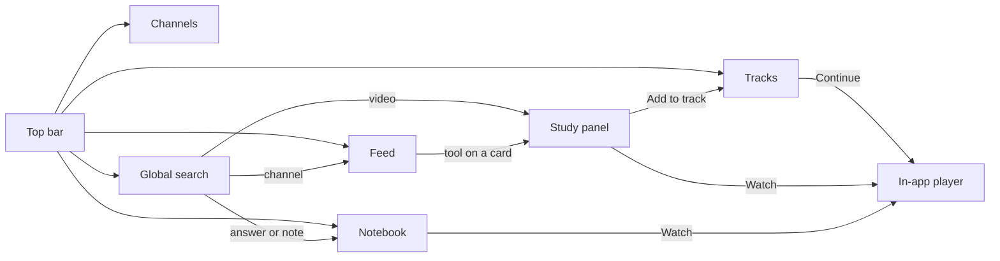
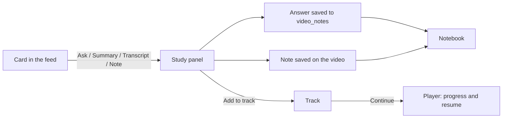
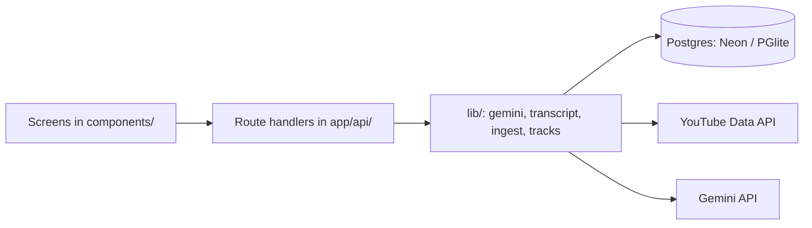

# TUBEBOX — UI/UX Redesign

> The working document for the redesign: what we're changing, why, how each
> change was built, and where we are. **New session? Start at "Resume here".**
> For how the system works underneath (data model, Gemini engine, ingestion),
> see [ARCHITECTURE.md](ARCHITECTURE.md) — this file doesn't repeat it.

Design source: Claude Design project "TubeBox Redesign" (rounds 2 and 3),
shared as https://claude.ai/artifact/MP44nprvvt3auamdQkwRYk

Phase 9 source ("calm base, retro accents"): studying Dan Vega's site,
Gumroad and neobrutalism.dev, then a side-by-side preview page agreed with
the owner (removed once built; `/styleguide` shows the result). See §2 *v2*
for the rules and where each idea came from.

---

## ▶ Resume here

| | |
|---|---|
| **Status** | **Redesign complete: Phases 1–10 built**, plus PERF-03 (instant screens) REF-09 (pen tagline, "See its videos") and REF-10 (genre-coloured channel tag). 1–9 committed; Phase 10, PERF-03, REF-09 and REF-10 built 2026-10-17, uncommitted, awaiting the owner's review. |
| **Phases done** | 10 of 10 (plus 4.1) |
| **Next step** | The owner tests the app (behaviour should be identical to Phase 9), then commits and pushes. Also uncommitted (2026-10-18): the Apify-outage message, the Firecrawl backup, parallel refresh, FIX-01 and PERF-04 (changelog). Before deploying, add `FIRECRAWL_API_KEY` to Netlify's environment variables (it applies on the next deploy). After deploying: refresh should take well under 30s, even after hours idle. And one check: a logged-out request to an API route should answer 401 (CLEAN-03; not testable locally without a password). |
| **Where things are** | Current design: §2. Every change, one line each: §4; full write-ups: [redesign-history.md](redesign-history.md). Code layout: [ARCHITECTURE.md](ARCHITECTURE.md) "UI layer". |
| **Open questions** | Parked ideas waiting for a yes: FEAT-11 greeting, FEAT-12 "Pick up where you left off". Still unanswered: turning off Next's Turbopack build cache (`experimental.turbopackFileSystemCacheForBuild: false`), which caused the stale-styles deploy and slow builds. |
| **Last updated** | 2026-10-19 |

*Update this block at the end of every session.*

---

## 1. Goals and retro rules

**Goals.** TUBEBOX works, but it grew feature by feature and the interface
shows it: seven buttons on every card, panels squeezed inside cards, an icon
legend for shorts, filters spread over five rows, the same heavy styling on
everything. The redesign makes it cleaner and easier to use while keeping its
personality — without losing a single feature.

**Retro rules — never broken:**
- Cream background, black outlines, hard offset shadows.
- The TV mascot is the logo.
- Bold display type for headings and labels.
- Colour is reserved for genres and the one primary action on a screen.
- Heavy treatment (thick shadow, filled yellow) only for primary or selected
  things; everything else stays light.

**Revised for Phase 9 (agreed 2026-10-17).** Phases 1–8 applied these rules
almost everywhere, and the result felt loud and "vibe-coded". Phase 9 keeps
the identity and changes the dose. The new rules:
- **Calm base, retro accents.** Most of the screen is quiet: soft 1px lines,
  one muted grey, slight rounding. The retro identity lives in a few
  deliberate places: the TV mascot, Archivo Black titles, Space Mono numbers,
  the sticker-shadow main button, the marker and the pen.
- **Hard shadows are earned.** At rest, only the main button has one. A card
  gets the black outline and shadow while you hover it: it lifts.
- **Yellow means something:** selected, "on", or the main action.
- **Hand-drawn touches have one job each:** the yellow marker means "you are
  here", the blue pen writes margin notes.

The full v2 rules are in §2 *v2*; the original list above is kept for history.

**Ground rules for the build:**
- Every existing feature keeps working throughout; we change the look and the
  layout, not the behaviour, unless an item says otherwise.
- One phase at a time; the owner checks each phase before the next.
- Free tier only. No new paid services.

---

## 2. Design system

The single source of truth for the look. Code follows these values.

> This is the design system today (v2, built in Phase 9). The Phases 1–8
> values it replaced are in [redesign-history.md](redesign-history.md).

### v2 — calm base, retro accents (Phase 9 · agreed and built 2026-10-17)

**Reference:** the running app and its `/styleguide` page. (While designing,
a self-contained preview page showed a screenshot of the old feed next to
the same videos under these rules; it was removed after Phase 9 was built.)

#### Why a v2

After Phases 1–8 the owner said it worked brilliantly but looked "vibe-coded".
A measurement of the code backed that up: every choice had been made on the
spot, so nothing was exactly consistent.

| Measured in the code (2026-10-17) | Count |
|---|---|
| Colour tokens | 15, including **7 near-identical creams** (cream, surface, panel, tint, tint-2, line, line-2) |
| Shades used for secondary text | **8** (`muted`, `muted-2`, `ink/55`, `/60`, `/70`, `/75`, `/80`, `/85`) |
| Places with a 2px black border (`border-2 border-ink`) | 70 |
| Places with a hard shadow at rest (`shadow-hard*`) | 25 |
| Text sizes | 7 named, plus one-offs like `text-[11px]` |
| Icons | hand-drawn in `Icon.tsx`, not from a designed set |

When everything has a black border and a shadow, nothing stands out, and the
eye notices 7 creams and 8 greys even when you can't say why.

#### Where the ideas came from

We studied three references (no purchase needed: two are open source under
MIT, one is a public repo). We took *rules*, not looks.

| Source | Link | What we took | What we left |
|---|---|---|---|
| **Dan Vega's site** (Nuxt 4) | [github.com/danvega/danvega-dev-nuxt](https://github.com/danvega/danvega-dev-nuxt) · danvega.dev | Personality **in a few places only** (his `$ whoami`, `./watch --youtube` buttons, code window) on a calm base; quiet grey icons that darken on hover; one accent colour; generous space. From a dashboard screenshot of his: bold section headings with a **handwritten blue note** beside them, and soft colour tiles for each app. | The swoosh under his name in the greeting (too literal a copy: the owner asked for inspiration, not copying). His base looks like Tailwind's "Spotlight" template (his header code still has a `Header.tsx isHomePage` comment left from a React original), so the base polish is from professional designers. |
| **Gumroad** (Rails + React, MIT) | [github.com/antiwork/gumroad](https://github.com/antiwork/gumroad) | **Discipline:** a few fixed values and nothing in between (5 text sizes, 3 grey strengths derived from the text colour, 2 shadow sizes, 3 corner sizes); 1px borders; the hard shadow **appears only on hover** (buttons lift 4px, pressing flattens them). Read: `app/javascript/stylesheets/tailwind.css` (`@theme`), `_definitions.scss`, `components/Button.tsx`, `components/ui/ProductCard.tsx`. | Their font (ABC Favorit) is paid. Their icon set (Boxicons). |
| **neobrutalism.dev** (shadcn/ui-based kit, MIT) | [github.com/ekmas/neobrutalism-components](https://github.com/ekmas/neobrutalism-components) · neobrutalism.dev | Proof that a yellow bold-border theme works with **~6 colour tokens** (background, secondary background, main, foreground, border, shadow): see `public/r/styling/yellow.json`. The **spinner in a badge** for waiting ("Syncing"): `src/components/ui/spinner.tsx` (the owner's pick, see *Waiting* below). | Their "press into the shadow" hover (we chose Gumroad's lift); their icon set (Lucide); it has components only, no page templates. |
| **Phosphor Icons** (MIT) | [phosphoricons.com](https://phosphoricons.com) · `@phosphor-icons/core` | The **duotone** weight: an outline plus a soft fill layer, drawn by professional designers. It's the "sticker duotone" idea from UI-06, done properly. | — |
| **Caveat** (Google Fonts, OFL) | fonts.google.com/specimen/Caveat | The handwriting face for the pen. | — |

What Dan's site is built with, for reference: Tailwind 3 +
`@tailwindcss/typography` + `@tailwindcss/forms`, Headless UI (menus,
dialogs), Heroicons (about five in the whole site), Simple Icons for brand
logos, zinc greys + one blue accent, the system font + mono.

#### Colours (v2)

| Token | Value | Use |
|---|---|---|
| `page` | `#fbf6ec` | Page, top bar, sidebar: **one** cream |
| `surface` | `#fffdf8` | Cards, inputs, the selected sidebar row |
| `ink` | `#1a1712` | Text, the hover/selected outline, shadows |
| `muted` | `#6f675b` | **The only** secondary-text colour |
| `line` | ink at 13% | Every quiet border and divider |
| `yellow` | `#ffd02b` | Selected, "on", the main button, the marker, inside lit icons |
| `danger` | `#e5484d` | Errors and destructive actions |
| `pen` | `#2c55c7` | **Handwriting only** |

Also allowed, each for one job: genre colours (user-defined, unchanged); four
soft tints for the sidebar view tiles (Inbox `#ffe9a3`, Watch later
`#ffd6ec`, Watched `#cdeed8`, Everything `#d6e4ff`); a green "synced" dot;
the brown warning text for quiet channels.
Gone: `panel`, `tint`, `tint-2`, `line-2`, `faint`, `muted-2`, `pink`, the
`ink/NN` text shades, and the page's dot grid.

**In code** (`app/globals.css` `@theme`): `page` keeps its old class name
`cream` (`bg-cream`) and `yellow` keeps `primary` (`bg-primary`), so screens
didn't need every class renamed. The one-job colours are `ok`, `warn` and
`tile-yellow` / `tile-pink` / `tile-green` / `tile-blue`. `--color-*: initial`
removes Tailwind's own palette, so an off-system colour can't creep back in
(it simply doesn't exist as a class).

#### Type (v2)

Same three fonts, plus Caveat for the pen. **Six sizes, no one-offs:**

| Size | Class | Used for |
|---|---|---|
| 12px | `text-xs` | Small labels (Space Mono caps), badges, counts |
| 13px | `text-meta` | Metadata, secondary controls, "Synced 3h ago" |
| 14px | `text-sm` | Body, buttons, sidebar rows (also the page default) |
| 15px | `text-lg` | Card titles (semibold) and the line under a page title |
| 22px | `text-xl` | Section headings (Space Grotesk bold) |
| 40px | `text-display` | Page titles (Archivo Black) |

`--text-*: initial` removes Tailwind's other sizes, so `text-2xl` or
`text-[11px]` can't sneak back in.

Space Mono only for numbers and small labels. Its spaces are a full character
wide, so a sentence in it looks gappy: "Synced 3h ago" uses the body font.

#### Shape, borders, shadows (v2)

- **Corners:** 4px `rounded-xs` (badges), 6px `rounded-sm` (rows, small
  buttons), 8px `rounded-md` (inputs, buttons, segmented controls), 10px
  `rounded-lg` (cards, panels). Square corners are retired.
- **Borders:** 1px `line` at rest. 1px `ink` on hover or when selected. The
  main button: 1.5px `ink`.
- **Shadows (hard, no blur), only two:**
  - *Sticker* `3px 3px 0 ink`: the main button (Add channel) at rest. On
    hover it rises 1px; on press it flattens.
  - *Lift* `5px 5px 0 ink` + move up-left 3px: a card or a "pick up" tile
    while you hover it.
  - In code: `shadow-sticker`, `shadow-lift`, and the `.lift` class (flat
    with a soft line; on hover it moves, darkens its border and drops the
    shadow). Menus and pop-overs also use the sticker shadow: they sit "on
    top" of the page.
- **No dot grid.** The calm base is plain cream.

#### Icons (v2) — Phosphor duotone

- **One designed set:** Phosphor, duotone weight (bold weight for the plain
  check, plus and arrow). Our `Icon` component keeps its API; only what it
  draws changes.
- **At rest:** `muted` outline, fill layer at Phosphor's default 20%. Quiet.
- **Hover:** outline turns `ink`, the fill turns solid `yellow`, and a soft
  rounded tile appears behind the button.
- **"On"** (has saved answers, has a note, saved for later): stays lit the
  same way. **One signal per state:** no extra red dot, no yellow box around
  the icon (the owner: the yellow belongs *inside* the icon).
- **Pick icons whose fill has a real body.** Some icons' fill is only a
  sliver (a folded corner, a pencil tip), so they barely light up. This is
  why Transcript is `article` (not `file-text`), Note is `notepad` (not
  `note-pencil`) and Add to track is `stack-plus` (not `list-plus`).
- **Open shapes never get the yellow** (refresh, check, plus, arrows). They
  use Phosphor's regular or bold weight, with no fill layer, and on hover
  they only turn ink. A yellow refresh icon looked like a smudge: its "fill"
  is just thin slivers (the owner: "feels cheap").
- **The refresh icon turns on hover:** a quarter turn (90°, 0.35 s, with a
  slight overshoot). Movement, not colour, hints at what it does.

#### Waiting: one spinner everywhere

Source: neobrutalism.dev's Spinner
([`src/components/ui/spinner.tsx`](https://github.com/ekmas/neobrutalism-components/blob/main/src/components/ui/spinner.tsx)
and its "With Badge" and "In Button" examples). Theirs is Lucide's `Loader2`
spinning. Ours is the same idea in our icon set.

- **The spinner is Phosphor's `circle-notch`** (bold), spinning once every
  0.75 s (slower if the system asks for reduced motion). It's a round arc, so
  it turns smoothly. Today we spin the refresh icon, whose arrowheads make it
  wobble.
- **Always with a word that says what's happening.** The spinner never
  appears alone.
- **Only one thing moves.** The button that started the wait goes faded and
  still.

| Where | While waiting |
|---|---|
| Sync (top bar) | "● Synced 3h ago" becomes a badge: ◌ **Syncing** (1.5px ink border, 6px corners, `surface`, 13px semibold). The sync button fades and doesn't spin. Afterwards: "● Synced just now", and the "N new videos" message as now. |
| Ask (study panel, Notebook) | ◌ Thinking… |
| Backfill (Channels) | ◌ Backfilling 2 of 5… |
| Any button busy with a request | ◌ Please wait, with the button disabled |

The preview's sync button demonstrates the first row (a fake 2.6 s sync).

| Use | Phosphor icon |
|---|---|
| Ask | `chat-circle-dots` |
| Summary | `sparkle` |
| Transcript | `article` |
| Note | `notepad` |
| Add to track | `stack-plus` |
| Mark seen | `check` (bold) |
| Watch later | `bookmark-simple` |
| Inbox · Watch later · Watched · Everything | `tray` · `clock-countdown` · `check-circle` · `television-simple` |
| Search · Sync · Add · "All 13 channels →" · Play | `magnifying-glass` · `arrows-clockwise` · `plus` (bold) · `arrow-right` (bold) · `play` |

#### The marker and the pen (personality)

Two hand-drawn tools, one job each, like a notebook on a desk:

| Tool | Colour | Job | Where |
|---|---|---|---|
| **Marker** | yellow | "You are here" | Under the active tab in the top bar: a slightly tilted felt-tip stroke (SVG path `M3 8.5 C 28 4.5, 62 3.5, 97 5.5`, 5.5px, round caps, 112% of the word's width, 9px below it). Other tabs show it faintly (45%) on hover. |
| **Pen** | blue | Margin notes | **At most one per screen, beside the page title**: Caveat 700, 23px, tilted −2.5°. It says what makes the page different. Never instructions, never on cards. |

The marker is thick because yellow on cream is faint; the active tab's word
also turns ink and bold, so the tab is clear even without the stroke. The
sidebar doesn't get the marker: its selected row already shows a white box
and a yellow count.

| Screen | Pen note |
|---|---|
| Inbox | newest first, no algorithm |
| Watch later | saved for a slower day |
| Watched | seen it, kept it |
| Everything | (none: it's just everything) |
| Shorts | no endless scroll here |
| Notebook | every answer you kept |
| Notebook, when empty | every answer you keep lands here |
| Tracks | one step at a time |
| Channels | only the ones you chose |
| Empty inbox ("You're all caught up") | nothing new. go outside? |
| Style guide | calm base, retro accents |

In code: the `.pen-note` class (`globals.css`), and `PageTitle`'s `note`
prop.

Other personality, kept small: the TV mascot; soft colour tiles for the four
sidebar views; mono caps for small labels ("YOUR FEED", "GENRES").

#### Screen pieces (v2), as in the preview

- **Top bar:** `page` background, 1px `line` underneath, 64px tall (65 with
  the line: the sticky sidebars and panels start at 65px). Tabs are plain
  text (muted; the active one ink + marker) with plain mono counts. "Search
  everything" box with ⌘K (it covers channels, videos, answers and notes).
  "● Synced 3h ago" and the sync icon button sit together as one tight group
  (8px apart), then **Add channel**, the one sticker button.
  - *Laptops (below 1280px):* the "Synced 3h ago" words and the "Add
    channel" words hide (the dot and the ＋ stay, and say it on hover), so the
    bar stays on one row.
  - *Phones:* row 1 is logo, sync and ＋; row 2 the four tabs (they scroll
    sideways if they must, no scrollbar shown); row 3 the search box.
- **Sidebar:** `page` background, 1px line on the right. Groups "Your feed",
  "Genres", "Channels". Rows are 34px with 6px corners; the selected row is
  `surface` with a `line` ring, semibold, and a yellow count chip. Counts
  elsewhere are plain mono. Genre dots are small rounded squares; channels
  show their round avatar.
- **Page head:** title (40px) + pen note on one line; under it "699 to watch
  · about 261 hours" on the left and the controls on the right ("Filter this
  list", Videos/Shorts, length).
- **Card:** flat `surface` with a 1px `line` border and 10px corners; lifts
  on hover. The ✓ and bookmark corners appear on hover and stay visible once
  set (set = 1.5px ink ring + yellow inside the icon). Duration in mono on
  85% ink. Progress bar 5px: yellow on a dark track. Title 15px semibold, 2
  lines; meta is the channel as a tag filled with its genre colour (text
  ink, or white on dark colours; grey with no genre; REF-10) and the age
  (muted). The tool row
  is ghost icon buttons; Ask keeps its word and a yellow mono count badge
  when answers exist.

---

## 3. Decisions log

| Decision | Choice | Reason |
|---|---|---|
| Theme | Cream & yellow (original), refined | It's TUBEBOX's identity; "Paper & red" rejected |
| Logo | Keep the TV mascot | Ours is better than the design's placeholder |
| Logo hover | Speech bubble "your feed · no algorithm" | Keeps the tagline without the ticker |
| Ticker | **Dropped** | A constantly scrolling banner fights "stay focused" |
| Corners | Square | Matches the design; sharper retro-print look |
| Dot background | Keep, much fainter | Part of the identity, but quieter |
| Watch on YouTube | **Dropped** — in-app player only | YouTube's recommendations defeat the app's purpose, and leaving the app breaks honest-watched, resume and progress |
| Shorts card shape | Keep landscape | Real short thumbnails are landscape; portrait would crop text |
| Keyboard shortcuts | **Dropped**, except search: ⌘K, and ↑↓ / Enter / Tab / Esc inside the search panel | Not needed for navigation; search is where keys are expected |
| Merging similar question chips (Notebook) | **Dropped** | Every answer already shows under "Any" and in search |
| Track reordering | Keep ▲▼ buttons | Already built and reliable; drag-and-drop not needed |
| Ask suggestions | Genre suggestion + up to 3 everyday suggestions **you edit** | Config over code; empty list = today's behaviour |
| Notebook copy | "Copy as Markdown" per video + "Copy all" in a ⋯ menu | Both useful |
| Notebook reader scope | Filters choose videos; the reader always shows the whole video, matching answers marked | Answers vanishing while you read loses your place |
| Notebook address | `/notebook?v=<id>` for the open video | Reload keeps your place; Phase 8 search can link to it |
| Track "last watched" | New `videos.last_played_at`, stamped by progress saves only | A hand-ticked ✓ isn't watching; the stamp rides an update that already happens |
| Track label genre | The most common genre among its videos | Tracks have no genre of their own; nothing new to keep in step |
| Tracks order | Most recently watched first, then newest | The tracks you're on stay at the top |
| Video player | Restyled in Phase 6 (drawn ✕, channel and length, square frame) | Shared by every screen; it was the last old-style piece |
| Play unseen in a row | Marks a short seen only when it plays to the end; Next skips without marking | Skipping isn't watching (the honest-watched rule) |
| Shorts title | "Shorts", with the view in the line under it | Says where you are; the sidebar still marks the view |
| Space Mono for numbers | Yes | Digits line up neatly |
| Bulk re-sync (now Backfill) | One channel at a time; each in as many short requests as it needs (FEAT-10) | Netlify kills any request after 10 s |
| Top-bar search box | Appeared in Phase 8 with global search | A box that does nothing is worse than no box |
| Search results | Open the existing place (feed filtered, study panel, Notebook), no results page | Those screens already show each thing best |
| Search engine | ILIKE + trigram similarity, one parallel request; no full-text index | ~140 ms at personal scale; nothing new to maintain |
| "Synced X ago" source | New `app_meta` table, written by every sync | The newest video's time stays old when a sync finds nothing |
| Feed tab count | All unwatched, videos + shorts | The feed's own totals line shows the per-view numbers |
| Sidebar count rule | What clicking the row would show, keeping your other choices | One rule for views and genres, so numbers never contradict the grid |
| Sidebar channel counts | Unchanged: the channel's whole archive of this kind | Stable numbers that don't jump while browsing (an earlier deliberate choice) |
| Shorts card | Gets the new card in Phase 3, not Phase 7 | It's one component; a second, old-style card would mean keeping all the popup code alive |
| Study panel loading | A tab loads only when picked, once | Summary and transcript can cost a Gemini call; nothing is spent by just opening the panel |
| Everyday suggestions storage | `app_meta` row (`ask_suggestions`), edited on the Channels page | Three strings don't need a table; empty by default |
| Channels address | `/channels`; `/manage` forwards there | The nav says Channels; old bookmarks keep working |
| "Quiet" channel | Active, and no upload in 90+ days (or none stored) | Long enough to skip normal gaps; short enough to catch abandoned channels |
| Bulk changes | One request for move/pause/resume/delete; backfill one channel at a time | Netlify's 10 s limit only bites on re-sync, which calls YouTube |
| Delete confirm | An in-page sentence with the counts, not the browser's pop-up | It can say exactly what goes, including answers and notes |
| Title search | Stays in the feed's title row until Phase 8 | The top bar gets a search box only when global search works |
| Icon style | B, "sticker duotone": ink outline, yellow fill in closed shapes | Adds depth and the yellow; pixel icons (C) only stay crisp at fixed sizes |
| Yellow amount | Yellow for selection, counts, the main button and inside icons; bars on soft cream | Pale yellow bars read as "urine yellow" |
| **Phase 9 direction** (2026-10-17) | "Calm base, retro accents" (§2 *v2*), keeping the retro theme | The owner wanted Dan Vega's "cool, professional" feel without losing retro; open to change only if it was clearly better, and the preview was |
| References | Dan Vega's site (personality in few places), Gumroad (discipline), neobrutalism.dev (6-token yellow theme) | Take rules, not looks; all free to study (two MIT, one public) |
| Corners (v2) | 6 / 8 / 10px rounding; **replaces "Square"** | The single biggest step toward "professional"; matches Dan's site and Gumroad |
| Shadows (v2) | Only the main button at rest; cards lift with a shadow on hover | When everything has a shadow, nothing feels clickable (Gumroad's approach) |
| Borders (v2) | 1px soft line at rest; ink on hover/selected | 2px black on 70 elements made every screen loud |
| Colours (v2) | 8 tokens (one cream, one muted grey) | Replaces 15 tokens, 7 creams and 8 text greys |
| Dot grid (v2) | Dropped | Part of the noise; the approved preview has none |
| Icons (v2) | **Phosphor duotone**, fill recoloured yellow on hover/"on"; **replaces** the hand-drawn set | A designed set is consistent in ways hand-drawn icons aren't. UI-06 had rejected Phosphor for its faint grey fill; recolouring the fill layer with CSS solves that. Heroicons (Dan's) and Lucide (neobrutalism.dev) are outline-only, so they can't hold yellow inside |
| Icon hover fill | Keep it, on every tool icon consistently | The owner liked it; it only felt cheap while half the icons barely filled |
| Open-shape icons (refresh, check, plus, arrows) | No yellow; plain outline that turns ink on hover; refresh turns 90° | Their fill is only slivers, so yellow looks like a smudge |
| Waiting indicator | One spinner (Phosphor `circle-notch`) + a word, everywhere; sync shows a "Syncing" badge | From neobrutalism.dev's Spinner; a spinning refresh icon wobbles, and the text didn't say what was happening |
| Saved bookmark | Yellow inside the icon, white box with an ink ring; not a solid yellow box | The yellow belongs inside the icon (the owner) |
| "Has a note" | The note icon stays lit; the red dot is dropped | One signal per state |
| Active tab | Hand-drawn yellow marker stroke; faint on hover | The owner's idea: a slanted stroke like Dan's, but in yellow and with a job ("you are here") |
| Handwriting | Blue pen (Caveat), at most one note per screen, beside the page title | Personality that stays special; blue is reserved for words |
| Greeting ("Good morning, Chandan.") | **Parked** (FEAT-11) | Needs the owner's name stored somewhere; and the first try copied Dan's swoosh too literally |
| "Pick up where you left off" | **Parked** (FEAT-12) | A new feature, not a look change; needs no new tracking when it's wanted |
| Top search text | "Search everything" | It covers channels, videos, answers and notes; listing three of four was wrong |
| Page search text | "Filter this list" | It no longer looks like a second copy of the top search |
| Starred / recently used | Not needed | Notebook already gathers everything asked and noted |
| Code cleanup | Phase 10, right after Phase 9 | Doing it during the redesign would clash with the same files |
| Bringing in Phosphor (Phase 9 build) | Copy the 27 icons' shapes into `components/ui/iconPaths.ts` (MIT notice kept); no package | Keeps one small `Icon` component and its API; the yellow lighting is our own CSS anyway |
| Old token names in code | Keep `cream` (= v2 `page`) and `primary` (= v2 `yellow`) | Every screen already used them; renaming would be churn with no visible change |
| Tailwind's default palette and sizes | Removed (`--color-*`, `--text-*`, `--radius-*: initial`) | Off-system values can't creep back: they no longer exist as classes |
| `primary` buttons | Full size = the sticker (shadow at rest); small = yellow + ink edge, shadow on hover | Keeps "one sticker per screen" while panels still get a yellow action (Watch, Continue, Save) |
| Sync status while syncing | "Syncing" badge with the spinner; the refresh icon stays still | Only one thing moves |
| Top bar on laptops (below 1280px) | Hide the "Synced…" and "Add channel" words (dot and ＋ stay, with hover labels) | The bar wrapped onto two rows at 1024px, and the sticky sidebar would slide under it |
| Top bar on phones | Logo, sync, ＋ / then the tabs (scroll if needed) / then search | The four tabs ran off a 375px screen |
| Pen notes not in the plan | Watched "seen it, kept it", Shorts "no endless scroll here", empty Notebook "every answer you keep lands here", Style guide "calm base, retro accents"; none on Everything or Track complete | Same rule: says what makes the page different, one per screen |
| Note indicator, "Short" badge, Undo link | Lit note icon (no dot); "Short" in the same dark chip as the duration; Undo in yellow on the dark "Seen" chip | `pink` was retired; fewer colours, same meaning |
| `components/Emoji.tsx` | Deleted | Nothing uses typed emoji for controls any more |
| Speed (after Phase 10) | Remember each screen's last data in the tab and refresh in the background; reuse visited pages for 5 min (`staleTimes`) | Revisits were paying two ~0.8 s trips to the US; now zero (PERF-03) |
| Clearing remembered data | Any change through `api()` (and a sync) clears it all; ✓ / bookmark / progress update it in place | Never show stale data after an edit, without losing the speed on the most frequent actions |
| Thumbnails | Keep the full-size image | The owner prefers the current look; the 8× smaller file stays an option |
| Not now | Server-rendered first data; moving server + database nearer India; lazy-loading the study panel code | Bigger rework, a database move, or a small gain on a laptop (PERF-03 alternatives) |
| Logo hover tagline (after PERF-03) | Written in the blue pen in a small card; only on hover | Personality where you reach for it; an always-on note would crowd the bar (REF-09) |
| "Add channel" label | Kept; the "Added…" message links to the channel's videos instead | Says what the button does; Channels and Feed already have their own tabs (REF-09) |
| Genre colour on cards (after REF-09) | The channel name as a filled tag (B), not a dot (A), coloured text (C) or darkened text (D) | The owner's choice after seeing all four on real cards; coloured text fails on light genres (yellow, lime, sky) (REF-10) |
| Channels: sort by genre (after Phase 9) | Yes: grouped A→Z / Z→A, "No genre" last, channels A→Z inside; Status not sortable | Sorting shows every genre grouped (filtering shows one); status already has its own filter buttons |

---

## 4. Change catalogue (index)

Every change, one line each. The full write-ups — the problem, the change,
how it works, key code, alternatives, files, verified — are in
[redesign-history.md](redesign-history.md), with a map of where files moved
in Phase 10. New items are written there in the same seven-part format.

| ID | Change | Status |
|---|---|---|
| UX-01 | Cards: two quick toggles and a tool strip | ✅ 2026-10-16 |
| UX-02 | Study panel on the right | ✅ 2026-10-16 |
| UX-03 | One top bar | ✅ 2026-10-16 |
| UX-04 | Feed sidebar: views, genres and channels in one place | ✅ 2026-10-16 |
| UX-05 | Type and length as segmented controls | ✅ 2026-10-16 |
| UX-06 | Shorts use the same card grammar | ✅ 2026-10-17 |
| UX-07 | Notebook as list and reader | ✅ 2026-10-17 |
| UX-08 | Tracks as list and path | ✅ 2026-10-17 |
| UX-09 | Channels page replaces Manage | ✅ 2026-10-17 |
| UI-01 | Design tokens in one place | ✅ 2026-10-16 |
| UI-02 | Visual hierarchy: heavy only where it matters | ✅ 2026-10-16 |
| UI-05 | Shared building blocks | ✅ 2026-10-16 |
| UI-06 | Icons and warmth (Phase 3 review fixes) | ✅ 2026-10-16 |
| UI-03 | Consistent page layout | ✅ 2026-10-17 |
| UI-04 | Sentence case for controls | ✅ 2026-10-17 |
| UI-07 | Calm base, retro accents | ✅ 2026-10-17 |
| UI-08 | Phosphor duotone icons | ✅ 2026-10-17 |
| REF-01 | Logo with a hover tagline | ✅ 2026-10-16 |
| REF-02 | Human wording | ✅ 2026-10-17 |
| REF-03 | Space Mono for numbers | ✅ 2026-10-16 |
| REF-04 | Loading placeholders | ✅ 2026-10-16 |
| REF-05 | Remove the ticker | ✅ 2026-10-16 |
| REF-06 | Empty states that say what to do next | ✅ 2026-10-17 |
| REF-07 | The marker and the pen | ✅ 2026-10-17 |
| REF-08 | Wording pass | ✅ 2026-10-17 |
| REF-09 | The logo's tagline in the pen; "See its videos" after adding a channel | ✅ 2026-10-17 |
| REF-10 | Channel name as a genre-coloured tag on cards | ✅ 2026-10-17 |
| FEAT-01 | Global search | ✅ 2026-10-17 |
| FEAT-02 | Sidebar and nav counts | ✅ 2026-10-16 |
| FEAT-03 | Seen with Undo | ✅ 2026-10-16 |
| FEAT-04 | Play unseen in a row | ✅ 2026-10-17 |
| FEAT-05 | Ask from the Notebook | ✅ 2026-10-17 |
| FEAT-06 | Track "last watched" | ✅ 2026-10-17 |
| FEAT-07 | Channel last upload and status | ✅ 2026-10-17 |
| FEAT-08 | Bulk channel actions | ✅ 2026-10-17 |
| FEAT-09 | Everyday Ask suggestions | ✅ 2026-10-16 |
| FEAT-10 | Backfill 1Y–5Y replaces Re-sync (Phase 4.1) | ✅ 2026-10-17 |
| FEAT-11 | Greeting | ⏸ parked |
| FEAT-12 | Pick up where you left off | ⏸ parked |
| CLEAN-01 | Names that say what they are | ✅ 2026-10-17 |
| CLEAN-02 | Shared building blocks instead of copies | ✅ 2026-10-17 |
| CLEAN-03 | API routes: one login check, safe ids | ✅ 2026-10-17 |
| CLEAN-04 | Screens in their own folders, big files split | ✅ 2026-10-17 |
| CLEAN-05 | Docs that match the code | ✅ 2026-10-17 |
| PERF-03 | Instant screens: remembered data and reused pages | ✅ 2026-10-17 |
| PERF-04 | Lighter thumbnails (WebP, same size), first row loads first | ✅ 2026-10-18 |
| FIX-01 | Channels with "bold" names can't be filtered (handle match + plain letters on save) | ✅ 2026-10-18 |
| FIX-02 | Dictated questions vanished from the Ask box (cursor now kept in it) | ✅ 2026-10-19 |

---

## 5. Screen by screen

| Screen | Items |
|---|---|
| Top bar (every screen) | UX-03, REF-01, REF-05, FEAT-01, FEAT-02 |
| Feed | UX-01, UX-02, UX-04, UX-05, FEAT-02, FEAT-03, FEAT-09, REF-04, REF-06 |
| Shorts | UX-06, FEAT-04 |
| Study panel | UX-02, FEAT-09 |
| Notebook | UX-07, FEAT-05 |
| Tracks | UX-08, FEAT-06 |
| Channels | UX-09, FEAT-07, FEAT-08 (+ FEAT-09 settings) |
| Search | FEAT-01 |
| All screens | UI-01, UI-02, UI-03, UI-04, UI-05, REF-02, REF-03 |
| All screens (Phase 9) | UI-07, UI-08, REF-07, REF-08 (finishes UI-03, UI-04, REF-02, REF-06) |
| Feed (parked) | FEAT-11, FEAT-12 |

---

## 6. Build plan

Phases are ordered by dependency and impact. New features land with the
screen they belong to. After each phase: typecheck, lint, production build, a
check in the running app, and the owner's review.

- [x] **Phase 1 — Foundation:** UI-01, UI-02, REF-03, UI-05 (button, icon
      button with hover label, segmented control, panel, sidebar list,
      style guide page)
- [x] **Phase 2 — App shell:** UX-03, REF-01, REF-05, nav counts (FEAT-02)
- [x] **Phase 3 — Feed:** UX-04, UX-05, UX-01, UX-02, FEAT-03, FEAT-09,
      sidebar counts (FEAT-02), REF-04 (+ the new card for shorts, from UX-06)
- [x] **Phase 4 — Channels:** UX-09, FEAT-07, FEAT-08
- [x] **Phase 4.1 — Backfill:** FEAT-10 (Re-sync → Backfill 1Y–5Y; page-by-page ingestion that carries on past Netlify's 10 s)
- [x] **Phase 5 — Notebook:** UX-07, FEAT-05
- [x] **Phase 6 — Tracks:** UX-08, FEAT-06 (+ the shared video player restyled)
- [x] **Phase 7 — Shorts:** rest of UX-06 (title row), FEAT-04
- [x] **Phase 8 — Search:** FEAT-01
- [x] **Phase 9 — Calm base, retro accents:** UI-07, UI-08, REF-07, REF-08;
      finishes UI-03, UI-04, REF-02, REF-06 on every screen. Suggested order:
      tokens and type scale (`globals.css`) → `Icon.tsx` on Phosphor → shared
      blocks (`components/ui/*`) → top bar (marker) → feed and card → study
      panel and player → Notebook, Tracks, Channels, Shorts, search → pen
      notes and empty states → `/styleguide`.
- [x] **Phase 10 — Code cleanup:** CLEAN-01 names (D), CLEAN-02 shared
      building blocks (A), CLEAN-03 API routes (B), CLEAN-04 screens in
      folders and big files split (C), CLEAN-05 docs (E) — behaviour
      unchanged apart from clean 400s for bad ids and one backfill-Stop bug
      fixed.

UI-03, UI-04, REF-02 and REF-06 are applied to each screen as its phase lands.

---

## 7. Flows

### Moving around

### Studying a video

### Where data goes

---

## 8. Changelog

| Date | What |
|---|---|
| 2026-10-16 | Redesign planned: design reviewed (rounds 2 and 3), decisions recorded, change catalogue and 8-phase plan written. |
| 2026-10-16 | **Phase 1 — Foundation done:** design tokens in `@theme` (UI-01), lighter shadow hierarchy (UI-02), Space Mono (REF-03), five building blocks + `/styleguide` (UI-05). Whole app now on the refined palette with square corners. Typecheck, lint, production build clean; all screens load without errors. Reviewed by the owner. |
| 2026-10-16 | Phase 2 (App shell) built: one top bar on every page with nav counts and "Synced X ago" (new `app_meta` table, `/api/nav`), logo speech bubble, ticker removed. Reviewed by the owner. |
| 2026-10-16 | Phase 3 (Feed) built: sidebar with counts, title row with segmented controls, new card (corner toggles, tool strip, Seen + Undo) for videos and shorts, study panel (Ask conversation, Summary, Transcript with find, Note), everyday Ask suggestions, loading placeholders, feed empty states. |
| 2026-10-16 | Phase 3 review fixes (UI-06): "sticker duotone" icons chosen and applied to the feed and top bar, sync label fixed, warmth restored then softened (`panel` colour), yellow Load more, darker secondary text. |
| 2026-10-17 | Phase 4 (Channels) built: /channels replaces Manage (forward kept) with add bar, sortable table, last upload and quiet status, bulk bar (move, pause, resume, re-sync one at a time, delete with confirm), row ⋯ menu, genres panel, Ask suggestions moved in, phone layout. |
| 2026-10-17 | Phase 4.1 (FEAT-10): Re-sync replaced by Backfill 1Y–5Y (row menu, bulk bar, "Try backfilling 3 years" hint); ingestion now saves page by page with a 6 s budget and a cursor to carry on; add-channel uses it too. |
| 2026-10-17 | Phase 5 (Notebook) built: list + reader (search, genre and question dropdowns, All/Answers/My notes, matching answers marked, `?v=` address), follow-up Ask in the reader, Copy as Markdown per video and Copy all in a ⋯ menu, note invitation/editor, phone list→reader flow, drawn icons. |
| 2026-10-17 | Phase 6 (Tracks) built: two panes (tracks with progress, time left and last watched; the chosen track as block bar, Up next with Continue, and the path with hover ▲▼✕), in-page delete confirm, rename with the name selected, `?t=` address, phone flow; new `videos.last_played_at` stamped by progress saves; video player header restyled. No typed icons left anywhere. |
| 2026-10-17 | Phase 7 (Shorts) built: Shorts title row with "Play unseen in a row" (plays unseen shorts back to back, marks each seen when it finishes, Next skips without marking, loads more pages as it goes); player shows "Short N of M unseen". |
| 2026-10-17 | Phase 8 (Search) built: global search in the top bar (channels, videos, answers and notes; scope tabs, highlights, `@` for channels, ⌘K and keyboard), results open the feed (channel / study panel / search), or the Notebook; new `/api/search` and `GET /api/videos/:id`. **All 8 phases done.** |
| 2026-10-17 | Phases 1–8 committed and deployed. The first deploy shipped stale styles from Netlify's restored build cache (Next 16.3's Turbopack build cache); a "Retry without cache" deploy fixed it. |
| 2026-10-17 | **Phase 9 designed and approved**: studied Dan Vega's site, Gumroad and neobrutalism.dev; measured why the app felt "vibe-coded"; built a side-by-side preview (`docs/previews/style-preview.html`) and refined it with the owner: Phosphor duotone icons (with better-filling choices), the yellow bookmark moved inside the icon, the red note dot dropped, the yellow marker under the active tab, blue pen notes beside page titles, a wording pass; greeting and "Pick up where you left off" tried and parked. Written up as §2 *v2*, UI-07, UI-08, REF-07, REF-08, FEAT-11, FEAT-12 and Phases 9–10. Later the same day: one spinner for every wait (sync becomes a "Syncing" badge, from neobrutalism.dev's Spinner), and open-shape icons never fill yellow (the refresh icon turns on hover instead). |
| 2026-10-17 | **Phase 9 built** (UI-07, UI-08, REF-07, REF-08; finishes UI-03, UI-04, REF-02, REF-06): v2 tokens with Tailwind's defaults removed; one cream, one muted grey, 1px lines, 4–10px corners, six text sizes; hard shadow only on the sticker button and hovered cards (`.lift`); Phosphor duotone icons copied into `iconPaths.ts` with CSS lighting (`icon-hover`, `lit`); one spinner (`Spinner`, `SpinnerBadge`, `Button busy`) and the "Syncing" badge; yellow marker under the active tab; blue pen notes via `PageTitle`; view tiles; wording pass (`formatWatchTime`); every screen restyled; top bar fixed for laptops and phones; tool row fixed on narrow short cards; `/styleguide` rebuilt for v2; `Emoji.tsx` removed. Typecheck, lint, build clean. |
| 2026-10-17 | Phase 9 review fixes (owner's testing): hover labels on a track step opened all three at once and stacked (the row's hover group triggered every button's label) — `IconButton` and the card's labels now listen to their own button only (named groups `group/ib`, `group/tip`); the path list and the Channels table no longer clip (`overflow-hidden` removed; it cut off labels on the first row and would cut the ⋯ menu on the last rows); the panel and player ✕ are framed again with labels opening below (they were frameless and their labels hid behind the top bar); Tracks' rename/delete labels open below; the Ask box (study panel and Notebook) empties as soon as you send and gets the text back only if the request fails. |
| 2026-10-17 | Channels table: the Genre column is sortable (grouped A→Z / Z→A, "No genre" last, channels A→Z within each group). Status stays filter-only. |
| 2026-10-17 | **Phase 10 (code cleanup) built**, behaviour unchanged: helper classes renamed (`.card`, `.field`, `.chip`) and old colour aliases removed (CLEAN-01); shared `SearchField`, `EmptyState`, `Thumb`/`Avatar`, `useDismiss`, `useCopy`, `highlight`, `useAsk`, `api()` and two CSS utilities replace 50+ copies (CLEAN-02); one login guard for 31 handlers and `parseId` for 17 id routes — bad ids now 400, not 500 (CLEAN-03); screens in `feed/`, `notebook/`, `tracks/`, `channels/` folders, the four big files split, feed data in `useFeedData`, and a Stop-flag bug in channel-add fixed (CLEAN-04); REDESIGN.md split into the current reference (2,648 → ~560 lines) and `redesign-history.md` (CLEAN-05). |
| 2026-10-17 | **PERF-03, instant screens:** screens remember their last data in the tab and refresh it in the background (`lib/api-client.ts`; changes clear it, ✓/bookmark/progress update it in place); visited pages reused for 5 min (`staleTimes.dynamic: 300`). Measured on a production build: revisits went from a page request + data requests with placeholders to 0 page requests, no placeholders, ~18 ms. Thumbnails left full-size by choice. |
| 2026-10-17 | REF-09: the logo's hover tagline is written in the blue pen; the "Added…" message on Channels ends with "See its videos →" (opens `/?channel=<id>`); "Add channel" keeps its name. Then the bubble was made smaller (18px), worded "your feed, no algorithm" and moved right so it clears the sidebar heading. |
| 2026-10-17 | REF-10: on feed and Shorts cards the channel name is a tag filled with its genre colour (the pre-redesign idea, without the heavy border); white text on dark colours via `textColorFor`; channels with no genre get a grey tag instead of yellow. |
| 2026-10-17 | Removed the Phase 9 design preview (`docs/previews/`) and the extra `.claude/launch.json` entries ("tubebox-prod", "previews"); the docs now point to `/styleguide`. |
| 2026-10-18 | Not UI, two production fixes (details in ARCHITECTURE.md, "Fixed 2026-10-18"). **Apify outage:** when the transcript Actor doesn't answer, Ask/Summary/Transcript now stop after one 15s try and say "The transcript service isn't responding right now…" instead of a 502 at 30s (`lib/transcript.ts`). **Refresh:** 5 channels are checked at once instead of one by one (`lib/ingest.ts`), so a refresh no longer runs into Netlify's 30s cut-off after a cold start; 24.1s → 4.9s in a 40-channel test with fake YouTube replies. **Firecrawl backup:** after Apify fails 3 times in a row, new transcripts come from Firecrawl for 30 minutes, then Apify is tried again (a circuit breaker kept in `app_meta`; needs `FIRECRAWL_API_KEY`). |
| 2026-10-18 | FIX-01: the feed sidebar's channel filter also matches the @handle (StarCode Kh's name is in Unicode "bold" letters that typing can't match); new channel names and video titles are saved with such letters turned plain (`plainLetters`, only U+1D400–U+1D7FF). Stored rows untouched by choice. |
| 2026-10-18 | PERF-04: thumbnails load as WebP (same full-size picture, 55% fewer bytes: first page 4.8 MB → 2.2 MB) with a JPEG fallback, including YouTube's 120px placeholder case; the feed's first row loads at once at high priority. For LCP, rated "Poor" in Netlify RUM. |
| 2026-10-19 | FIX-02: the Ask box (study panel and Notebook) takes the cursor when it opens and after each answer, so dictation (Willow Voice) lands in it; not on touch screens, never away from another text field (`useAsk` → `inputRef`). |
